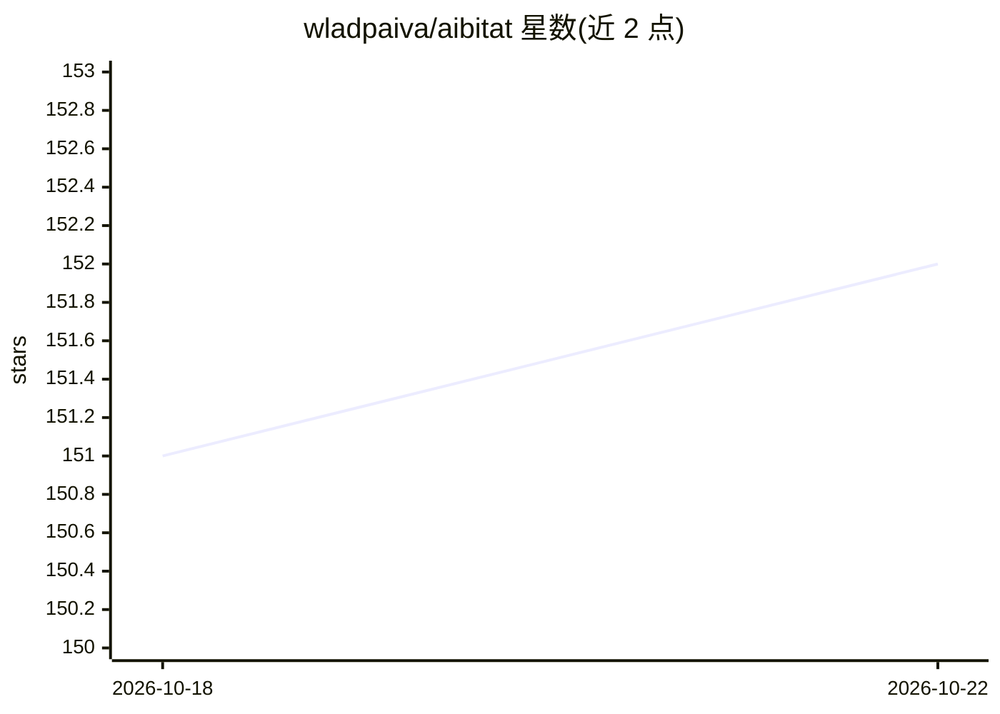

# wladpaiva/aibitat

⭐ 152 · TypeScript · MIT · 推送 2026-10-14 · [GitHub](https://github.com/wladpaiva/aibitat) · 个人维护

**TypeScript 多智能体对话框架，支持人类参与**

AIbitat 是用 TypeScript 编写的多智能体对话框架，自称 AutoGen 的 TypeScript 分叉。以无状态、可扩展方式组织多个 agent 在频道中对话，允许人类作为可交互 agent 加入；默认使用 OpenAI GPT-3.5-Turbo 生成对话、GPT-4 预测下一个发言者。提供函数调用、插件机制（cli、fileHistory、实验性 web 浏览）与生命周期事件（start/error/message/terminate/interrupt）。通过 npm/bun 安装，面向 TypeScript 开发者。

## 筛选速览

| 维度 | 判定 | 备注 |
|---|---|---|
| AI 角色 | `ai-ecosystem` | LLM/agent 周边工具 |
| 许可风险 | `permissive` | MIT |
| 部署形态 | `None` |  |
| 模型依赖 | — | README 未给出锁定关系 |
| 硬件要求 | — | 无带数字的原话,不猜 |
| 安装摩擦 | `low` | 无编译、无系统依赖或容器化 |
| 成熟度 | `idea` | |

## 能力要点

- agent/channel 频道式组织多智能体对话，允许人类参与
- 函数调用与 AIbitatPlugin 插件接口扩展
- 生命周期事件与 interrupt/terminate/continue 控制机制
- 默认 OpenAI GPT-3.5-Turbo 对话、GPT-4 预测下一发言者

## 适用场景

- 搭建多个 AI agent 互相协作对话的应用
- 在 agent 对话中加入人类实时参与和干预
- 通过插件为 agent 添加 CLI、历史保存、网页浏览等能力

## 场景标签

 · 领域:LLM 基础设施/Agent 框架

## 证据(README 行号)

> L6: AIbitat is a stateless & extensible framework designed to enable interaction
> L9: Think of it as Slack but for AI agents. Create agents, add them to channels and

## 星数曲线

2026-10-18 151 → 2026-10-22 152（+1）

---
*卡片 v1 · prompt 1.4 · 生成 2026-10-22 · 置信度 high · 依据 README sha `769c22447ed2` · [字段定义](../../DATASET.md)*
