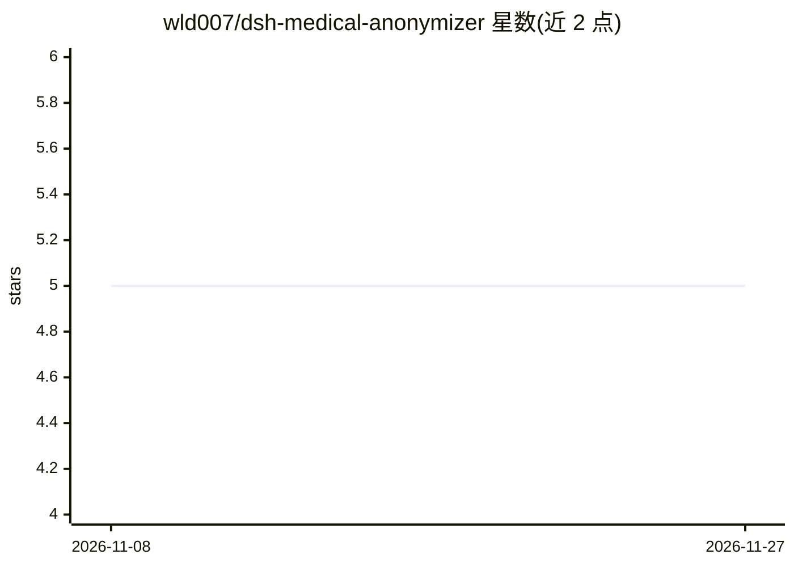

# wld007/dsh-medical-anonymizer

⭐ 5 · JavaScript · MIT · 推送 2026-11-24 · [GitHub](https://github.com/wld007/dsh-medical-anonymizer) · 个人维护 · 中文 README

**医疗病历批量匿名化 DSH 插件：假名替换+评估报告**

DeepSeek Harness 插件，批量处理病历文本、表格与 DICOM 元数据：规则层（身份证校验位、电话、邮箱、键名等）与识别模型叠加找出直接标识符，独立核验模型盲审，插件在原文精确定位并替换为跨文件一致的稳定假名，文件结构与行数不变。交付前按 K 匿名与标识度算匿名化程度，生成 Word 评估报告；病历只发往用户自配的 OpenAI 兼容端点，无遥测。不配模型时可只跑规则层，评测语料由模板生成，结果不能直接当作真实数据泄漏率。

## 筛选速览

| 维度 | 判定 | 备注 |
|---|---|---|
| AI 角色 | `ai-enhanced` | 去掉 AI 部分产品仍成立 |
| 许可风险 | `permissive` | MIT |
| 部署形态 | `None` |  |
| 模型依赖 | locked-api |  |
| 硬件要求 | — | 无带数字的原话,不猜 |
| 安装摩擦 | `low` | 无编译、无系统依赖或容器化 |
| 成熟度 | — | 结构信号不足 |

## 能力要点

- 三层识别：规则 + 识别模型 + 独立核验模型交叉核验
- 稳定假名跨文件一致，映射关系只存映射库
- K 匿名/A 标识度评估并生成待签署 Word 报告
- DICOM 元数据旁路处理，不经模型

## 适用场景

- 把一批病历脱敏后交给下游做病历事件还原、HL7 标准化或科研统计
- 机构内网或本机模型端点处理患者数据，避免数据外发
- 交付前生成匿名化效果评估报告供责任人签署

## 场景标签

`文档解析` · 领域:知识与检索

## 证据(README 行号)

> L29: - **三层识别**：规则、识别模型、独立核验模型叠加，解决不了的转人工，不静默放过（见下文）。
> L51: - **规则兜底**：格式固定的标识符不依赖模型，没配模型时插件也能只跑规则层。
> L114: - **识别模型**：OpenAI 兼容的 `/v1` 端点、模型名、API Key（可选），用「测试连接」检查。留空时只运行规则层，自由文本里的姓名、地址会漏掉很多。

## 星数曲线

2026-11-08 5 → 2026-11-27 5（+0）

---
*卡片 v1 · prompt 1.4 · 生成 2026-11-21 · 置信度 mid · 依据 README sha `bd0509123ac9` · [字段定义](../../DATASET.md)*
