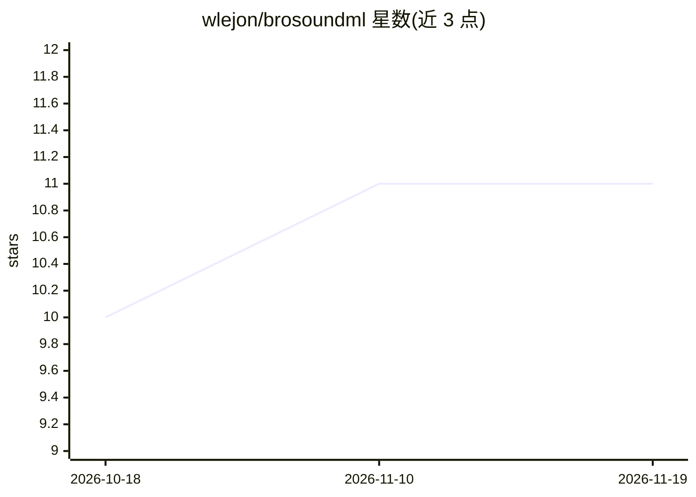

# wlejon/brosoundml

⭐ 11 · C++ · MIT · 推送 2026-11-09 · [GitHub](https://github.com/wlejon/brosoundml) · [官网](https://github.com/wlejon/bro) · 个人维护

**面向音频开发者的 C++ 神经音频模型推理库**

一个以 C++20 编写的库，通过 brotensor 算子图运行多种神经音频模型：Kokoro-82M/Qwen3-TTS/OmniVoice 文本转语音、Whisper/Parakeet-TDT/Qwen3-ASR 语音识别、Sortformer 说话人分离、RAVE 自编码器、CLAP 音频-文本打分、唤醒词与音素检出，并内置英语 G2P。仓库只含代码不含权重，权重存于独立 data 仓库；模型默认 FP32 在 CPU 运行，可通过 brotensor 的 CUDA/Vulkan/Metal 后端分发。以 CMake 源码构建，依赖提交级固定，版本为 Pre-1.0。

## 筛选速览

| 维度 | 判定 | 备注 |
|---|---|---|
| AI 角色 | `ai-native` | 本体是模型或模型工具 |
| 许可风险 | `permissive` | MIT |
| 部署形态 | `None` |  |
| 模型依赖 | — | README 未给出锁定关系 |
| 硬件要求 | `cpu-ok` | |
| 安装摩擦 | `high` | 编译与系统依赖俱全 |
| 成熟度 | — | 结构信号不足 |

## 能力要点

- 单一库覆盖 TTS、ASR、说话人分离、音频自编码、关键词检出与 G2P
- 模型图由 brotensor 设备无关算子构成，CUDA 构建可复现 CPU 结果
- 内置英语 G2P，Kokoro 音素化无需 misaki/Python 依赖
- 仅分发代码，权重与语音包位于独立 brosoundml-data 仓库

## 适用场景

- 在 C++ 项目中直接调用 TTS 或语音识别模型生成音频/文本结果
- 构建流式唤醒词检测与说话人分离管线
- 用 RAVE 与 HiggsAudio codec 做波形与编码/隐向量间的转换

## 场景标签

`语音合成` `语音识别` · 领域:内容生成

## 证据(README 行号)

> L7: brosoundml is a C++ library that runs neural audio models: text-to-speech,
> L8: speech-to-text, a neural audio autoencoder, and keyword spotting. You hand it a
> L10: gives you back synthesized audio or token ids.

## 星数曲线

2026-10-18 10 → 2026-11-19 11（+1）

---
*卡片 v1 · prompt 1.4 · 生成 2026-11-18 · 置信度 high · 依据 README sha `3951a51d2f04` · [字段定义](../../DATASET.md)*
