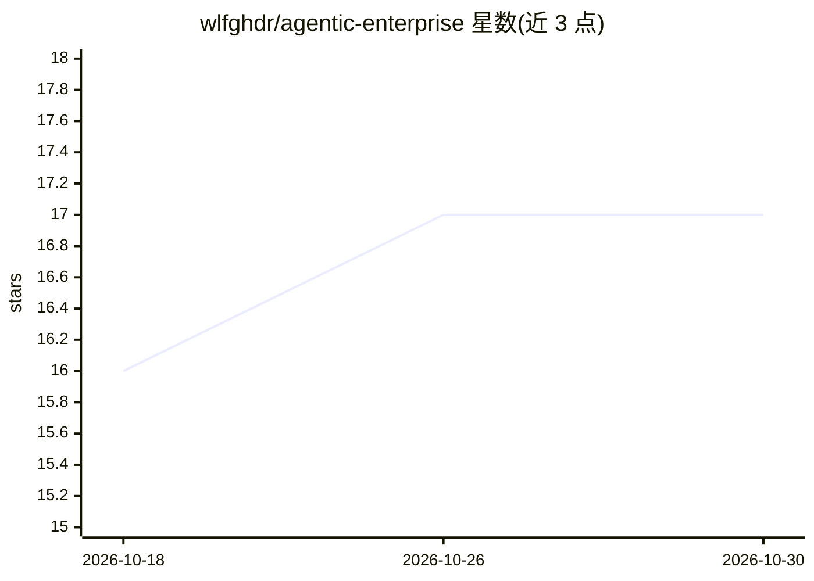

# wlfghdr/agentic-enterprise

⭐ 17 · Python · Apache-2.0 · 推送 2026-10-14 · [GitHub](https://github.com/wlfghdr/agentic-enterprise) · [官网](https://wlfghdr.github.io/agentic-enterprise/) · 个人维护

**以 Git 仓库承载的 AI agent 企业治理运营模型框架**

开源运营模型仓库：用 5 层治理结构（指导/战略/编排/执行/质量）与 4 个流程循环（发现/构建/发布/运营）组织 AI agent 参与的企业工作，人类决策、agent 执行，Git 历史充当审计轨迹。运行时无关，支持 Claude Code、OpenAI Agents SDK、CrewAI 等加载 AGENT.md 指令，附 11 项合规框架的自评模板。采用路径为 fork 仓库、填写 CONFIG.yaml、配置 CODEOWNERS，明确声明无需 agent 即可起步，且合规百分比为编辑性姿态标记而非认证。面向评估或引入 agent 治理的企业与管理者。

## 筛选速览

| 维度 | 判定 | 备注 |
|---|---|---|
| AI 角色 | `ai-ecosystem` | LLM/agent 周边工具 |
| 许可风险 | `permissive` | Apache-2.0 |
| 部署形态 | `None` |  |
| 模型依赖 | — | README 未给出锁定关系 |
| 硬件要求 | — | 无带数字的原话,不猜 |
| 安装摩擦 | `low` | 无编译、无系统依赖或容器化 |
| 成熟度 | `idea` | |

## 能力要点

- 5 层治理结构与 4 个循环，决策以 PR 合并记录、可回滚可追溯
- 运行时无关：Claude Code、OpenAI Agents SDK、CrewAI、LangGraph 等加载 AGENT.md 指令
- 19 项质量策略目录与 11 项合规框架的模板映射
- 最小采用路径无需 agent：fork、CONFIG.yaml、CODEOWNERS、信号与任务

## 适用场景

- 为引入 AI agent 的组织建立决策与审批治理结构
- 让 Git 历史充当组织级审计轨迹
- 以最小成本试点 signal-mission-PR 工作流

## 场景标签

 · 领域:企业治理/AI agent 运营

## 证据(README 行号)

> L61: **Agentic Enterprise** is an open-source operating model for running work through a governed Git repository. Humans
> L42: `agentic-enterprise` is the **operating model** of the agentic-* suite — three building blocks for running an agent

## 星数曲线

2026-10-18 16 → 2026-10-30 17（+1）

---
*卡片 v1 · prompt 1.4 · 生成 2026-10-29 · 置信度 high · 依据 README sha `dcf42712fa87` · [字段定义](../../DATASET.md)*
