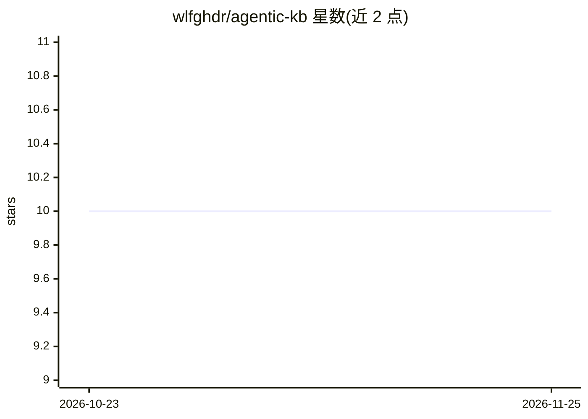

# wlfghdr/agentic-kb

⭐ 10 · Python · Apache-2.0 · 推送 2026-10-14 · [GitHub](https://github.com/wlfghdr/agentic-kb) · [官网](https://wlfghdr.github.io/agentic-kb/) · 个人维护

**给 AI agent 团队用的分层知识运营规范与 /kb 技能**

一套 AI-native 分层知识运营体系：由规范、参考技能与一个可移植 agent 组成，通过统一的 /kb 命令在任意 agentic IDE/harness 中运行。材料须经五问评估门持久化，agent 负责分诊、归档、交叉链接与逐层晋升/回传摘要；决策、想法、任务为带生命周期的一等对象。无数据库、无云后端，知识以纯 Markdown 存于 git 仓库随代码版本化；不自带调度器，需用户自行接 cron/CI。支持纯人工的捕获纪律阶段。

## 筛选速览

| 维度 | 判定 | 备注 |
|---|---|---|
| AI 角色 | `ai-knowledge` | 知识聚合/清单类 |
| 许可风险 | `permissive` | Apache-2.0 |
| 部署形态 | `None` |  |
| 模型依赖 | — | README 未给出锁定关系 |
| 硬件要求 | — | 无带数字的原话,不猜 |
| 安装摩擦 | `low` | 无编译、无系统依赖或容器化 |
| 成熟度 | — | 结构信号不足 |

## 能力要点

- 统一 /kb 命令跨 harness 使用（Claude Code、OpenCode、Gemini CLI、Codex CLI 等）
- 五问评估门：所有材料持久化前须通过，决策可追溯
- 分层结构：anchor→team→org→company 层间 promote/digest 双向流动
- 纯 Markdown + git 存储，无数据库无云后端，可随时移除

## 适用场景

- 让团队里多个 agent 与人共享同一套决策与上下文
- 会议纪要、决策、想法的统一归档与晋升流转
- 用 GitHub Issues/Projects/PR 搭建治理工作流
- 不引入数据库的前提下给仓库加知识运营层

## 场景标签

`知识库管理` `Agent 记忆` · 领域:Agent 开发

## 证据(README 行号)

> L4: > AI-native, layered knowledge operations. Vendor-neutral. No database. No cloud backend. Lives in your repo, next t
> L17: |agentic-kb|**The knowledge layer** — layered, vendor-neutral knowledge ops via the `/kb` command (this repo).|
> L55: |**1 — Capture discipline** (human-only baseline)|humans, every step|humans, by hand|git + markdown + the `agentic-

## 星数曲线

2026-10-23 10 → 2026-11-25 10（+0）

---
*卡片 v1 · prompt 1.4 · 生成 2026-11-19 · 置信度 mid · 依据 README sha `97697e89b94c` · [字段定义](../../DATASET.md)*
