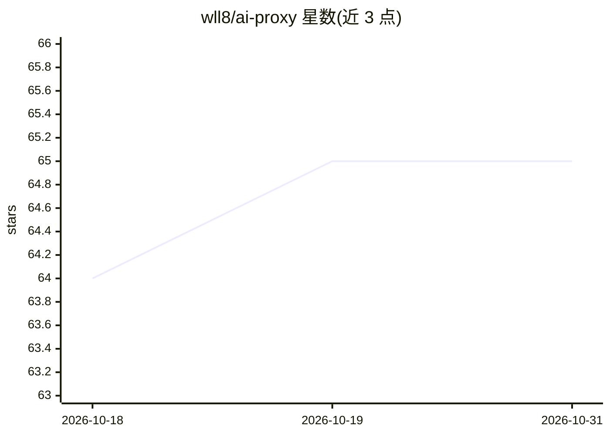

# wll8/ai-proxy

⭐ 65 · HTML · 推送 2026-01-14 · [GitHub](https://github.com/wll8/ai-proxy) · [官网](https://wll8.github.io/ai-proxy/) · 个人维护 · 中文 README

**AI API 公益/收费中转站收集清单**

个人维护的中转站列表仓库：以表格收录免费与收费两类 Claude Code / OpenAI API 中转站点，含链接、类型、备注与最后可用时间字段；声明不定时检测可访问性、不保证安全稳定、排名不分先后。可通过 PR 或 issues 提交新链接，列表由 npm run build 生成并同步到 GitHub。可配合 mcc 或 cc-switch 管理多站 key 与 baseURL。

## 筛选速览

| 维度 | 判定 | 备注 |
|---|---|---|
| AI 角色 | `ai-knowledge` | 知识聚合/清单类 |
| 许可风险 | `none` | — |
| 部署形态 | `library` | 以包/库形式分发 |
| 模型依赖 | — | README 未给出锁定关系 |
| 硬件要求 | — | 无带数字的原话,不猜 |
| 安装摩擦 | `low` | 无编译、无系统依赖或容器化 |
| 成熟度 | — | 结构信号不足 |

## 能力要点

- 免费与收费两类中转站表格，含最后可用时间字段
- 支持通过 PR / issues 由任何人添加链接
- npm 脚本本地运行与生成列表

## 适用场景

- 寻找 Claude Code / OpenAI API 的中转或公益站
- 配合 mcc / cc-switch 切换多个站的 key 与 baseURL

## 场景标签

`精选清单` · 领域:学习与行业

## 证据(README 行号)

> L1: # 中转站收集板
> L3: 在路边收集的一些中转站。不定时检测可访问性，不保证安全和稳定。
> L9: |站点名称|链接|类型|备注|最后可用时间|

## 星数曲线

2026-10-18 64 → 2026-10-31 65（+1）

---
*卡片 v1 · prompt 1.4 · 生成 2026-10-24 · 置信度 high · 依据 README sha `5b64a0d1c48a` · [字段定义](../../DATASET.md)*
