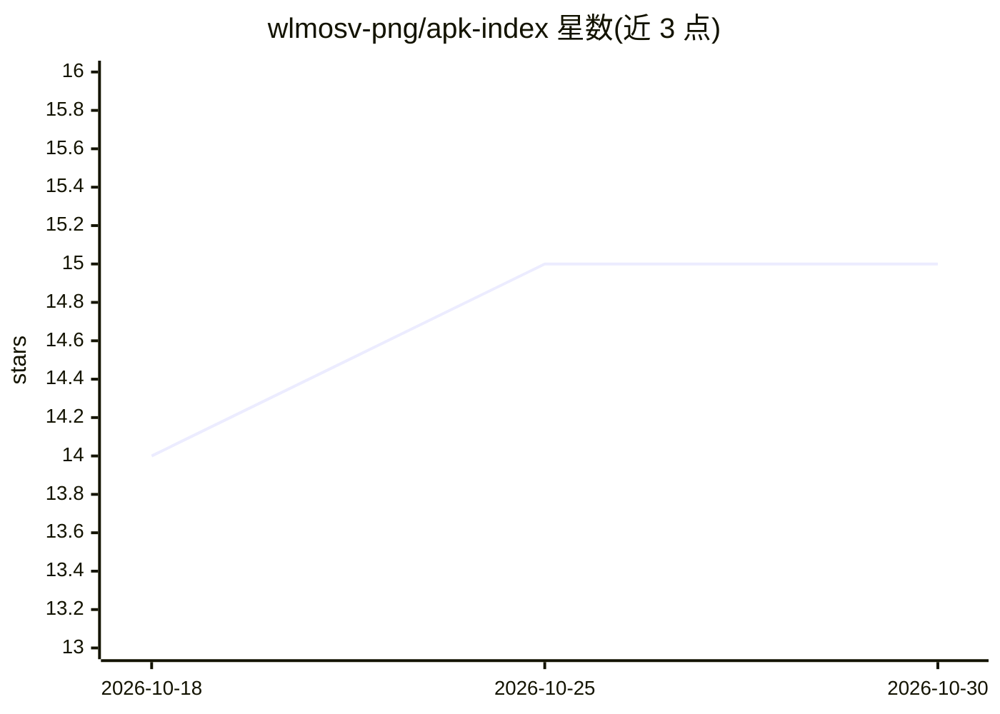

# wlmosv-png/apk-index

⭐ 15 · Python · MIT · 推送 2026-09-14 · [GitHub](https://github.com/wlmosv-png/apk-index) · 个人维护 · 中文 README

**零依赖 Python 的 APK/AAR/DEX 静态索引 MCP Server，供 Agent 逆向查询**

纯 Python 3 标准库实现的本地 MCP Server（stdio 与 Streamable HTTP 双传输），静态索引 APK/split APK/AAR/裸 dex/vdex/compact-dex，向 Agent 提供 23 个只读工具：查类、查成员、查签名、字符串反查、交叉引用、版本差分、manifest 与安全面汇总、加固探测、hook 起手块生成等。面向 Android 逆向与 Xposed 模块开发者。索引按 dex 内容去重、全局缓存共享，多客户端按 owner 隔离；不脱壳、不改源文件，缺 JADX/JDK 时走降级路径。

## 筛选速览

| 维度 | 判定 | 备注 |
|---|---|---|
| AI 角色 | `ai-ecosystem` | LLM/agent 周边工具 |
| 许可风险 | `permissive` | MIT |
| 部署形态 | `None` |  |
| 模型依赖 | — | README 未给出锁定关系 |
| 硬件要求 | — | 无带数字的原话,不猜 |
| 安装摩擦 | `low` | 无编译、无系统依赖或容器化 |
| 成熟度 | — | 结构信号不足 |

## 能力要点

- 23 个只读 MCP 工具覆盖类/成员/字符串/交叉引用/差分/安全面查询
- 纯 Python 标准库实现，无第三方依赖，索引写缓存不写源文件
- 多客户端 owner 隔离 + 索引文件全局共享与文件锁
- 支持 adb 从设备拉包、加固探测、双通道输出（人读渲染 + 机器 JSON）

## 适用场景

- Xposed 模块开发时让 Agent 静态反查目标 App 的类与成员
- 跨版本 APK 差分，识别改名/新增/删除的类
- Android 组件安全面审计（exported 组件、危险权限）
- 在手机上经 HTTP 端点连接本地 MCP 客户端做逆向

## 场景标签

`网络安全` · 领域:学习与行业

## 证据(README 行号)

> L1: # apk-index —— Android 逆向 / Xposed 模块开发用的 APK 索引 MCP Server
> L5: 「查类、查成员、查签名、查字符串、查交叉引用、生成 hook 起手块」的只读能力。
> L6: 纯 Python 3 标准库（zipfile / sqlite3 / struct / json / hashlib），stdio 上说 MCP JSON-RPC 2.0。

## 星数曲线

2026-10-18 14 → 2026-10-30 15（+1）

---
*卡片 v1 · prompt 1.4 · 生成 2026-10-30 · 置信度 high · 依据 README sha `f065e400dad3` · [字段定义](../../DATASET.md)*
