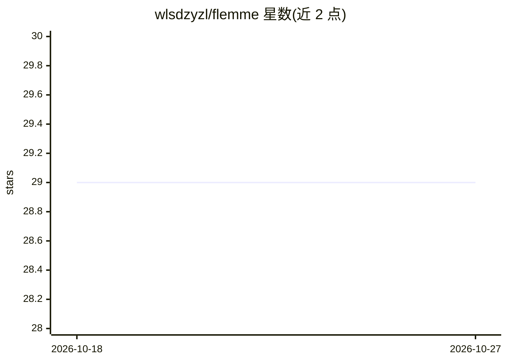

# wlsdzyzl/flemme

⭐ 29 · Python · 推送 2026-05-11 · [GitHub](https://github.com/wlsdzyzl/flemme) · [官网](https://flemme-docs.readthedocs.io/) · 组织维护

**医学影像模块化深度学习平台：免代码构建分割/重建/生成模型**

面向医学影像的深度学习平台，将编码器（CNN/UNet/ViT/Swin/VMamba 及点云的 PointNet/PointMamba 等）与模型架构（分类/分割/重建/生成，含 DDPM/DDIM/LDM）解耦，通过 yaml 配置文件组合即可构建模型，无需编写代码，提供 train_flemme/test_flemme 命令行训练与测试，并提出带金字塔损失的层次化架构。另维护 MedPointS 医学点云数据集（可从 Hugging Face 加载）。基础依赖为 torch 等，Mamba 与点云组件需 CUDA 及额外安装，可修改 config.py 禁用部分组件。

## 筛选速览

| 维度 | 判定 | 备注 |
|---|---|---|
| AI 角色 | `ai-native` | 本体是模型或模型工具 |
| 许可风险 | `none` | — |
| 部署形态 | `library` | 以包/库形式分发 |
| 模型依赖 | — | README 未给出锁定关系 |
| 硬件要求 | — | 无带数字的原话,不猜 |
| 安装摩擦 | `medium` | 含编译或系统依赖之一 |
| 成熟度 | — | 结构信号不足 |

## 能力要点

- 编码器与架构解耦，yaml 配置免代码构建模型
- 支持 2D/3D 影像与点云的分割、重建、生成（DDPM/DDIM/EDM/LDM 等）
- 层次化架构与金字塔损失用于垂直特征精炼
- 配套 MedPointS 大规模医学点云数据集（Hugging Face 可加载）

## 适用场景

- 医学影像（如 CVC-ClinicDB、BraTS21）上训练分割/重建/生成模型
- 用 yaml 配置快速尝试不同编码器与架构组合
- 医学点云的分类、补全与分割实验

## 场景标签

`图像生成` · 领域:内容生成

## 证据(README 行号)

> L4: Flemme is a flexible and modular learning platform for medical images. In Flemme, we separate encoders from the mode
> L53: Creating a deep learning model with Flemme is quite straightforward; you don't need to write any code. All things c
> L84: - [VAE, DDPM, DDIM, EDM, LDM] for generation.

## 星数曲线

2026-10-18 29 → 2026-10-27 29（+0）

---
*卡片 v1 · prompt 1.4 · 生成 2026-10-26 · 置信度 mid · 依据 README sha `96a94cf3a2a1` · [字段定义](../../DATASET.md)*
