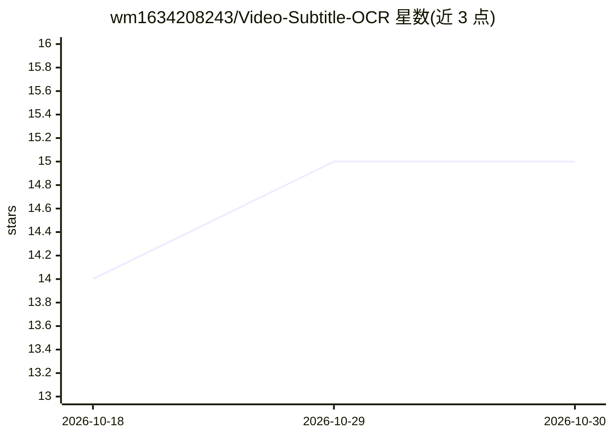

# wm1634208243/Video-Subtitle-OCR

⭐ 15 · Python · MIT · 推送 2026-07-15 · [GitHub](https://github.com/wm1634208243/Video-Subtitle-OCR) · [官网](https://github.com/wm1634208243/Video-Subtitle-OCR) · 个人维护 · 中文 README

**本机运行的视频字幕 OCR 工具：提取硬/软字幕并导出 SRT/TXT**

FastAPI 单服务加浏览器前端的本地字幕提取工具：优先导出内嵌文字软字幕，无软字幕时用 FFmpeg 抽帧、OpenCV 预处理、OCR 识别硬字幕。默认 PaddleOCR CPU，兼容 OpenVINO、ONNXRuntime、EasyOCR、Tesseract，支持多帧投票锁定字幕区域、重复帧复用结果、手动框选。可选配置 OpenAI、Anthropic、Ollama 或 OpenAI 兼容接口在合并字幕后修正文字，默认不调用大模型。提供 Windows/macOS/Linux 脚本、Docker Compose 与多档位安装。

## 筛选速览

| 维度 | 判定 | 备注 |
|---|---|---|
| AI 角色 | `ai-native` | 本体是模型或模型工具 |
| 许可风险 | `permissive` | MIT |
| 部署形态 | `desktop` | 安装包/桌面程序 |
| 模型依赖 | local-ok | 支持本地模型 |
| 硬件要求 | — | 无带数字的原话,不猜 |
| 安装摩擦 | `low` | 无编译、无系统依赖或容器化 |
| 成熟度 | — | 结构信号不足 |

## 能力要点

- 软字幕优先提取，无软字幕时 FFmpeg 抽帧+OCR 识别硬字幕
- 5 种 OCR 引擎可选，智能混合模式只复核低可信帧
- 多帧投票锁定字幕区域、重复帧复用结果减少无效 OCR
- 可选大模型（OpenAI/Anthropic/Ollama/兼容接口）修正 OCR 文本

## 适用场景

- 从带硬字幕的视频提取文字生成 SRT 字幕文件
- 批量提取视频软字幕轨道导出 SRT/TXT
- 用本地 OCR 处理中英混合字幕视频并导出可编辑文本

## 场景标签

`OCR` · 领域:感知与多模态

## 证据(README 行号)

> L3: 本机运行的视频字幕提取工具。启动一个 Python 服务，在浏览器里上传、拖入或粘贴视频，自动导出 `.srt` 和 `.txt`。
> L5: 处理流程会优先检查视频里是否有可直接导出的文字软字幕；如果没有，再用 FFmpeg 抽帧、OpenCV 预处理、OCR 识别硬字幕。
> L24: - 可选配置 OpenAI、Anthropic、Ollama 或 OpenAI 兼容接口，在合并字幕后用大模型修正 OCR 拼写、空格和标点；支持页面测试连接、保存配置和一键重置。

## 星数曲线

2026-10-18 14 → 2026-10-30 15（+1）

---
*卡片 v1 · prompt 1.4 · 生成 2026-10-30 · 置信度 high · 依据 README sha `cc3dd65fcc43` · [字段定义](../../DATASET.md)*
