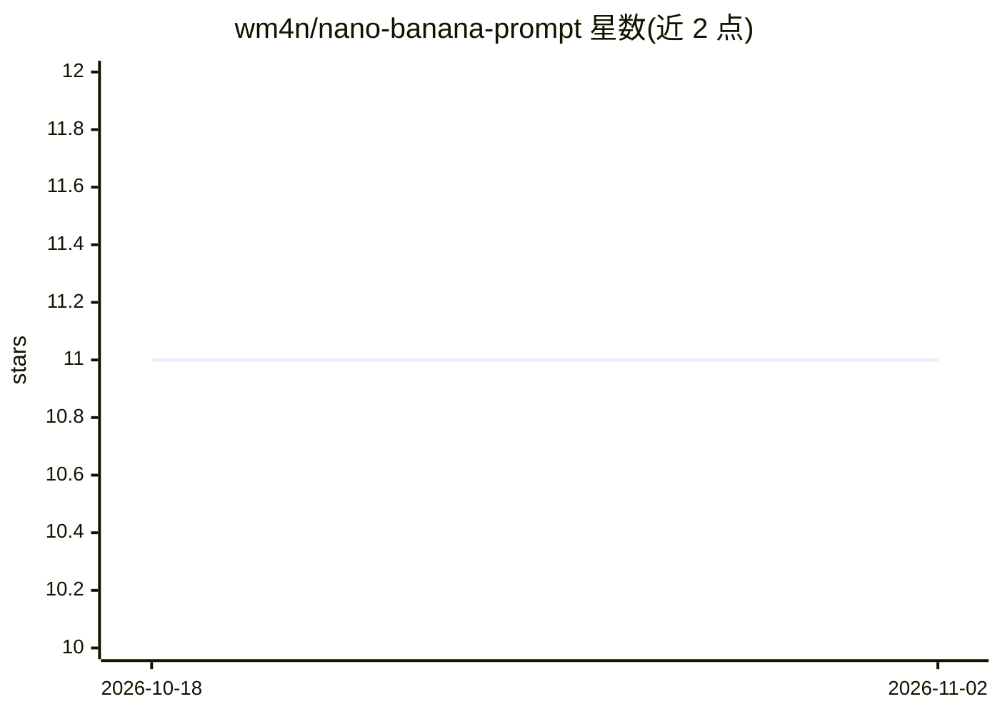

# wm4n/nano-banana-prompt

⭐ 11 · Shell · 推送 2026-07-14 · [GitHub](https://github.com/wm4n/nano-banana-prompt) · 个人维护

**Nano Banana 图像生成提示词策展库（115+ 条）**

面向 Nano Banana（Gemini 图像生成模型）用户的提示词合集：收录 115+ 条提示词，按 Art Styles、Character & Portrait、City & Architecture 等 10 个类别组织，通过 Hugo 静态站点发布为可搜索的画廊页面，每条提示词带示例图片和复制按钮。贡献者可通过交互式 CLI 脚本 new-prompt.sh 添加新提示词，标签集中管理于 tags.sh 并支持 AI 辅助重新分类；推送到 main 后由 GitHub Actions 自动重建站点。本地开发需安装 Hugo。

## 筛选速览

| 维度 | 判定 | 备注 |
|---|---|---|
| AI 角色 | `ai-knowledge` | 知识聚合/清单类 |
| 许可风险 | `none` | — |
| 部署形态 | `None` |  |
| 模型依赖 | — | README 未给出锁定关系 |
| 硬件要求 | — | 无带数字的原话,不猜 |
| 安装摩擦 | `low` | 无编译、无系统依赖或容器化 |
| 成熟度 | — | 结构信号不足 |

## 能力要点

- 115+ 条提示词按 10 个类别组织，附示例图片
- Hugo 静态站点画廊，提示词带独立复制按钮
- 交互式 CLI 脚本引导添加多步骤提示词，标签可由 AI 推断
- 支持单图与多步骤（multi-step）两种提示词格式

## 适用场景

- 浏览现成提示词激发图像创作灵感
- 按类别查找特定风格（如艺术风格、信息图）的提示词
- 贡献者批量整理和发布自己的提示词收藏

## 场景标签

`提示工程` `精选清单` · 领域:Agent 开发

## 证据(README 行号)

> L3: A curated gallery of **115+ AI image generation prompts** for Nano Banana — organized by category, searchable, with 
> L13: |🎨 Art Styles|22|

## 星数曲线

2026-10-18 11 → 2026-11-02 11（+0）

---
*卡片 v1 · prompt 1.4 · 生成 2026-11-01 · 置信度 high · 依据 README sha `4434efe9e032` · [字段定义](../../DATASET.md)*
