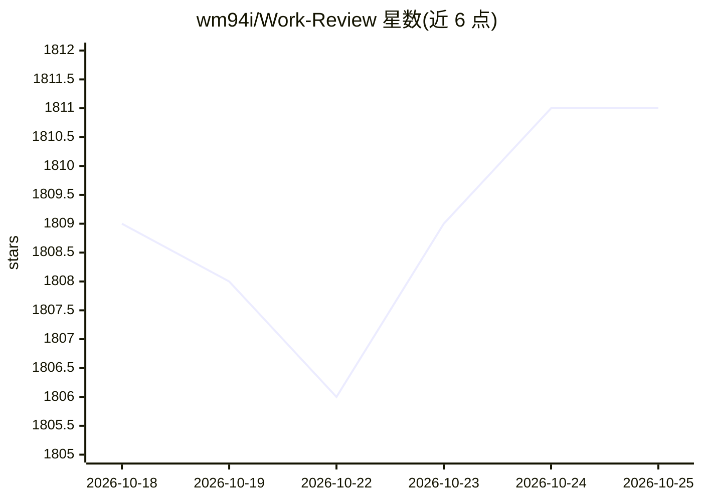

# wm94i/Work-Review

⭐ 1,812 · Rust · MIT · 推送 2026-10-25 · [GitHub](https://github.com/wm94i/Work-Review) · [官网](https://aiqst.com) · 个人维护 · 中文 README

**本地优先的个人工作记录与日报生成桌面应用**

面向个人用户的桌面应用：自动记录前台应用、浏览器页面、窗口标题、使用时长及可选截图与 OCR 文本，组织为可回看的时间线，并生成可导出 Markdown 的结构化日报。数据默认存储于本地 SQLite，不上传服务器；AI 功能默认关闭、完全可选，配置模型后可对本地记录问答与摘要，支持 Ollama、LM Studio、OpenAI 兼容及多家云端服务商。另提供桌面宠物头像、Telegram/飞书/钉钉/企业微信机器人集成、本地 HTTP API 与 MCP Server（Beta）。以 Tauri 2 + Rust + Svelte 4 构建，提供 macOS/Windows/Linux 安装包。

## 筛选速览

| 维度 | 判定 | 备注 |
|---|---|---|
| AI 角色 | `ai-enhanced` | 去掉 AI 部分产品仍成立 |
| 许可风险 | `permissive` | MIT |
| 部署形态 | `desktop` | 安装包/桌面程序 |
| 模型依赖 | local-ok | 支持本地模型 |
| 硬件要求 | — | 无带数字的原话,不猜 |
| 安装摩擦 | `medium` | 含编译或系统依赖之一 |
| 成熟度 | `idea` | |

## 能力要点

- 自动记录应用、网页、窗口标题、时长与可选截图/OCR 并组织为时间线
- 数据默认存本地 SQLite，AI 可选且默认关闭，模型调用使用用户自有 API key
- AI 增强模式支持 Ollama/LM Studio 本地及 OpenAI 兼容等多种服务商
- 内置约 140 域名 + 70 应用的分类知识库，含 AI 自动学习回填历史
- 提供 Localhost API 与 MCP Server，可接入 Claude Code/Cursor 等工具

## 适用场景

- 回顾今天实际做了什么、时间花在哪里
- 自动生成并导出每日工作日报
- 按应用/网站匿名化或忽略规则控制记录范围，保护隐私
- 通过 Telegram/飞书等机器人远程查询记录和生成日报

## 场景标签

`文档问答` · 领域:知识与检索

## 证据(README 行号)

> L9:  All data is stored locally by default and never uploaded to any server. AI features are entirely optional; the app 
> L151: The core of Work Review is always **local recording**. AI's role is to make records easier to read and review, not
> L38: - **Questions over local records** — Use the basic template or your configured model to answer "What did I do today

## 星数曲线

2026-10-18 1,809 → 2026-10-25 1,811（+2）

---
*卡片 v1 · prompt 1.4 · 生成 2026-10-21 · 置信度 high · 依据 README sha `292da88131dc` · [字段定义](../../DATASET.md)*
