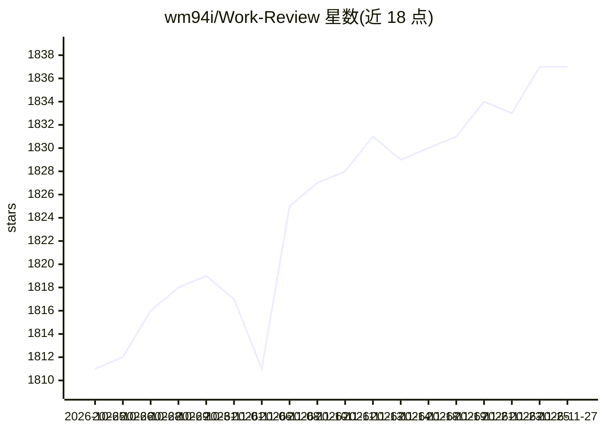

# wm94i/Work-Review

⭐ 1,837 · Rust · MIT · 推送 2026-11-26 · [GitHub](https://github.com/wm94i/Work-Review) · [官网](https://aiqst.com) · 个人维护 · 中文 README

**本地优先的个人工作回顾工具：记录应用与网页使用并生成日报**

本地优先的个人工作回顾桌面应用，自动记录前台应用、浏览器页面、窗口标题、使用时长、可选截图与 OCR 文本，组织为可回溯的时间线；提供总览统计、时间线回看、基于本地记录的问答（基础模板或自配置模型）、结构化日报生成与 Markdown 导出。数据默认存于本地 SQLite、不上传服务器，AI 功能默认关闭，需用户自配 API key，模型调用不经第三方中转。提供 macOS/Windows/Linux 安装包，并附带 Localhost API 与 Telegram/飞书/钉钉/企业微信机器人集成。

## 筛选速览

| 维度 | 判定 | 备注 |
|---|---|---|
| AI 角色 | `ai-enhanced` | 去掉 AI 部分产品仍成立 |
| 许可风险 | `permissive` | MIT |
| 部署形态 | `desktop` | 安装包/桌面程序 |
| 模型依赖 | local-ok | 支持本地模型 |
| 硬件要求 | — | 无带数字的原话,不猜 |
| 安装摩擦 | `medium` | 含编译或系统依赖之一 |
| 成熟度 | — | 结构信号不足 |

## 能力要点

- 自动记录前台应用、浏览器页面、窗口标题、时长与可选截图/OCR，组织为时间线
- 两种问答/日报模式：零配置基础模板与用户自配模型的 AI 增强模式
- 隐私控制：按应用 Normal/Anonymize/Ignore、敏感词过滤、域名黑名单、锁屏自动暂停
- Localhost HTTP API（Bearer Token 认证）与 Telegram/飞书/钉钉/企业微信机器人远程查询

## 适用场景

- 回顾今天实际做了什么、各任务花费了多少时间
- 快速整理并导出结构化日报
- 在纯本地、无 AI 配置的情况下记录和统计工作活动
- 通过即时通讯机器人远程查询记录和生成报告

## 场景标签

 · 领域:生产力/时间追踪

## 证据(README 行号)

> L5:  A local-first personal work review tool that records context, helps you review your day, and generates daily report
> L9:  All data is stored locally by default and never uploaded to any server. AI features are entirely optional; the app 
> L158: Supported providers: Ollama (local) / LM Studio (local) / OpenAI compatible / DeepSeek / Qwen / Zhipu / Kimi / Dou

## 星数曲线

2026-10-25 1,811 → 2026-11-27 1,837（+26）

---
*卡片 v1 · prompt 1.4 · 生成 2026-11-27 · 置信度 mid · 依据 README sha `f2a213593d2f` · [字段定义](../../DATASET.md)*
