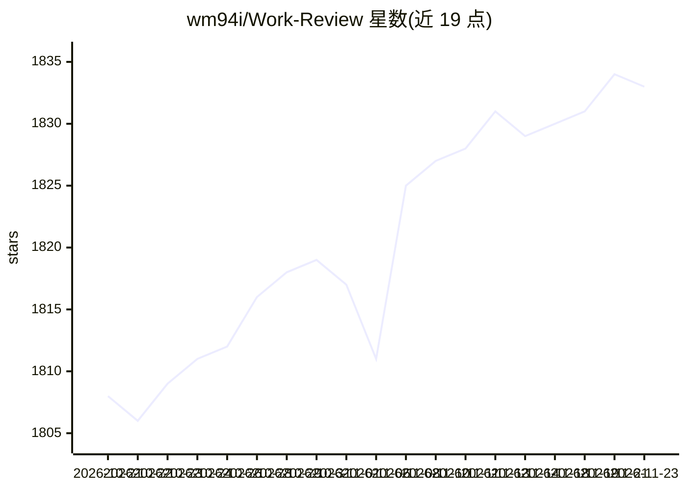

# wm94i/Work-Review

⭐ 1,833 · Rust · MIT · 推送 2026-11-11 · [GitHub](https://github.com/wm94i/Work-Review) · [官网](https://aiqst.com) · 个人维护 · 中文 README

**本地优先的个人工作时间回顾工具：记录、回顾并生成日报**

自动记录前台应用、网页、窗口标题、使用时长、可选截图与 OCR 文本，整理为可回顾的统一时间线，并基于本地记录回答问题、生成结构化日报（支持 Markdown 导出与自动导出）。数据默认存于本地 SQLite，不上传服务器。AI 部分完全可选：内置基础模板零配置可用，配置自有模型后启用 AI 增强问答与摘要，模型调用使用用户自己的 API key。提供 macOS/Windows/Linux 安装包，并带 Localhost HTTP API 与 Telegram/飞书/钉钉/企业微信 Bot 集成。

## 筛选速览

| 维度 | 判定 | 备注 |
|---|---|---|
| AI 角色 | `ai-enhanced` | 去掉 AI 部分产品仍成立 |
| 许可风险 | `permissive` | MIT |
| 部署形态 | `desktop` | 安装包/桌面程序 |
| 模型依赖 | local-ok | 支持本地模型 |
| 硬件要求 | — | 无带数字的原话,不猜 |
| 安装摩擦 | `medium` | 含编译或系统依赖之一 |
| 成熟度 | — | 结构信号不足 |

## 能力要点

- 自动记录前台应用、网页、窗口标题、时长、可选截图与 OCR
- 基础模板零配置生成结构化日报，AI 增强模式可选且默认关闭
- 本地 SQLite 存储，模型调用走用户自有 API key、无第三方中转
- Localhost API（127.0.0.1:47831）与 Telegram/飞书/钉钉/企业微信 Bot 集成

## 适用场景

- 回顾自己今天和近期实际做了什么、时间花在哪
- 快速汇总生成当日工作报告并导出 Markdown
- 在多设备上通过 IM Bot 远程查询记录和生成日报

## 场景标签

 · 领域:个人效率/工作记录

## 证据(README 行号)

> L9:  All data is stored locally by default and never uploaded to any server. AI features are entirely optional; the app 
> L36: - **Automatic work context recording** — Records foreground apps, browser pages, window titles, usage time, optiona
> L151: The core of Work Review is always **local recording**. AI's role is to make records easier to read and review, not

## 星数曲线

2026-10-21 1,808 → 2026-11-23 1,833（+25）

---
*卡片 v1 · prompt 1.4 · 生成 2026-11-23 · 置信度 mid · 依据 README sha `bb10467376cb` · [字段定义](../../DATASET.md)*
