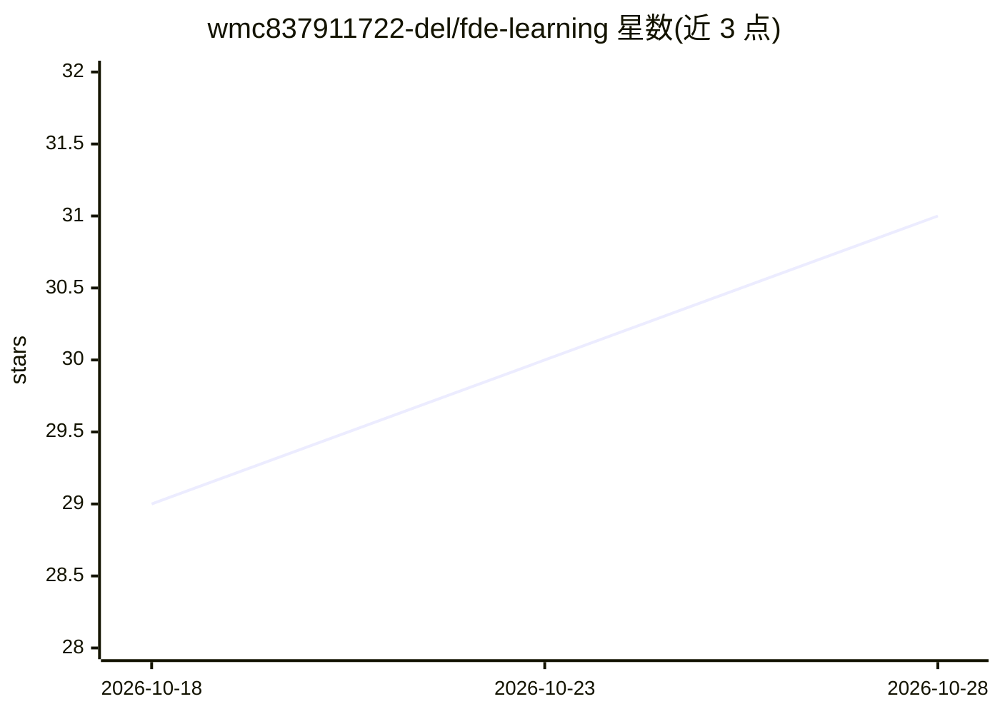

# wmc837911722-del/fde-learning

⭐ 31 · JavaScript · 推送 2026-09-12 · [GitHub](https://github.com/wmc837911722-del/fde-learning) · [官网](https://wmc837911722-del.github.io/fde-learning/) · 个人维护 · 中文 README

**24 周中文 FDE（前沿部署工程师）成长教程与模板仓库**

面向已有编程基础、零 FDE 经验学习者的中文公开教程，第 1–24 周均已发布，以 GitHub Pages 站点形式在线阅读。内容沿岗位认知→客户发现→工程交付→AI 评测与生产化→作品集→面试的主线组织，覆盖 RAG 评测、MCP 工具安全、可观察性与运营交接，提供 Discovery Brief、Eval Plan、项目评分模板及企业 RAG+MCP Capstone 项目合同。本地运行需 Node.js 22.13+ 与 pnpm 11.19.0。仓库声明首版未附开源许可证，保留全部权利。

## 筛选速览

| 维度 | 判定 | 备注 |
|---|---|---|
| AI 角色 | `ai-knowledge` | 知识聚合/清单类 |
| 许可风险 | `none` | — |
| 部署形态 | `library` | 以包/库形式分发 |
| 模型依赖 | — | README 未给出锁定关系 |
| 硬件要求 | — | 无带数字的原话,不猜 |
| 安装摩擦 | `low` | 无编译、无系统依赖或容器化 |
| 成熟度 | — | 结构信号不足 |

## 能力要点

- 24 周标准路线，可调整为 20 或 28 周
- 三个递进式项目，Capstone 为企业 RAG + MCP 助手
- 可复制的 Discovery Brief / Eval Plan / 项目评分模板
- 面向传统搜索与生成式引擎的内容结构（sitemap、llms.txt、来源标注）

## 适用场景

- 按周路线从零学习 FDE 岗位所需能力
- 用模板收敛客户需求、定义评测合同与发布门槛
- 以企业 RAG + MCP Capstone 项目构建作品集并准备面试

## 场景标签

`教程课程` · 领域:学习与行业

## 证据(README 行号)

> L3: 一套面向**已有编程基础、零 FDE 经验**学习者的中文公开教程，第 1–24 周均已发布。这里的 FDE 指 **Forward Deployed Engineer（前沿部署工程师 / 前线部署工程师）**。使用与转载边界见文末
> L5: 教程不以背诵工具清单为目标，而是沿着真实岗位要求完成一条可验证路径：

## 星数曲线

2026-10-18 29 → 2026-10-28 31（+2）

---
*卡片 v1 · prompt 1.4 · 生成 2026-10-26 · 置信度 mid · 依据 README sha `92ec5a4a398a` · [字段定义](../../DATASET.md)*
