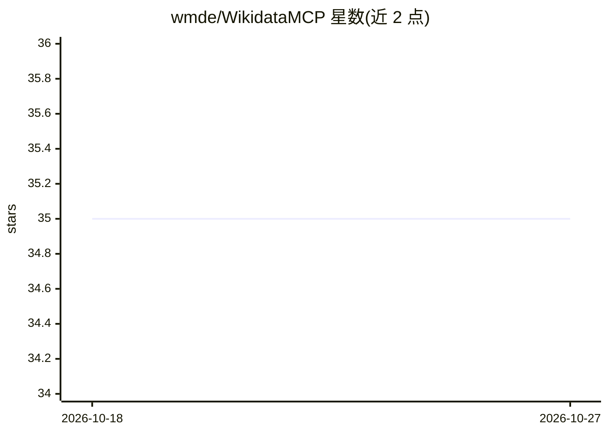

# wmde/WikidataMCP

⭐ 35 · Python · BSD-3-Clause · 推送 2026-09-21 · [GitHub](https://github.com/wmde/WikidataMCP) · [官网](https://wd-mcp.wmcloud.org/) · 组织维护

**Wikidata 的 MCP 服务器：让 LLM 搜索与查询维基数据**

由 Wikimedia Deutschland（wmde）维护的 Model Context Protocol 服务器，向 LLM 与 AI agent 暴露 6 个标准化工具：搜索 Wikidata 实体（QID）与属性（PID）、读取实体声明与完整声明值（含限定符、引用）、获取 instance of / subclass of 层级、执行 SPARQL 查询。搜索优先使用向量检索，回退到关键词检索。提供公共托管实例（wd-mcp.wmcloud.org），也可通过 uv 或 Docker Compose 本地运行，工具同时以 API 端点形式暴露并附带 Swagger 文档。

## 筛选速览

| 维度 | 判定 | 备注 |
|---|---|---|
| AI 角色 | `ai-ecosystem` | LLM/agent 周边工具 |
| 许可风险 | `permissive` | BSD-3-Clause |
| 部署形态 | `self-host` | docker 或自建部署 |
| 模型依赖 | — | README 未给出锁定关系 |
| 硬件要求 | — | 无带数字的原话,不猜 |
| 安装摩擦 | `low` | 无编译、无系统依赖或容器化 |
| 成熟度 | — | 结构信号不足 |

## 能力要点

- 6 个工具覆盖 QID/PID 搜索、声明读取、层级获取与 SPARQL 执行
- 搜索走向量检索并回退关键词检索
- 公共托管实例可直接接入 AI 应用，也可本地运行
- 声明值工具含限定符、引用与全部 rank，适合审计场景

## 适用场景

- 让 AI agent 通过 MCP 协议探索和查询 Wikidata
- 构建依赖 Wikidata 结构化知识的应用或研究工作流
- 需要来源与限定符完整信息的核查类任务

## 场景标签

`知识图谱` · 领域:知识与检索

## 证据(README 行号)

> L2: The **Wikidata MCP (Model Context Protocol)** provides a set of standardized tools that allow large language models 
> L4: The Wikidata MCP server is running at https://wd-mcp.wmcloud.org/ \

## 星数曲线

2026-10-18 35 → 2026-10-27 35（+0）

---
*卡片 v1 · prompt 1.4 · 生成 2026-10-25 · 置信度 high · 依据 README sha `d7214936337e` · [字段定义](../../DATASET.md)*
