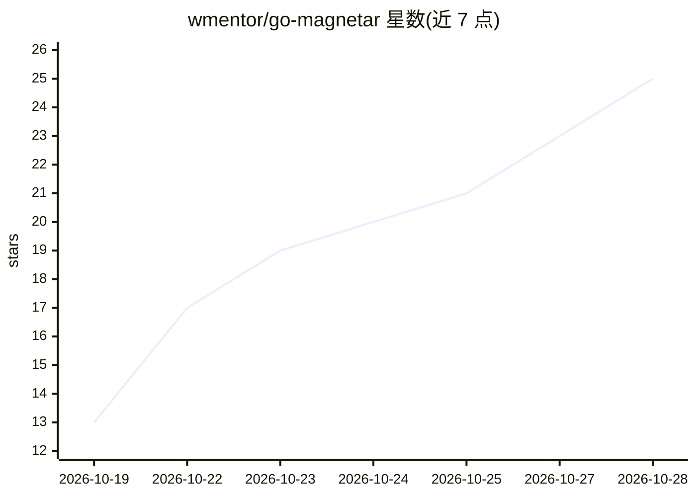

# wmentor/go-magnetar

⭐ 25 · Go · MIT · 推送 2026-10-27 · [GitHub](https://github.com/wmentor/go-magnetar) · 个人维护

**Go 单二进制 AI 聊天 agent：接入任意 OpenAI 兼容 LLM，带工具与 RAG**

以单个自包含 Go 二进制分发的命令行 AI 聊天 agent（harness）：多轮对话 REPL、自动上下文压缩，agent 可自动调用内置工具（文件读写、shell 执行、ripgrep 搜索、SSH、OSV CVE 查询、GitHub/Confluence/JIRA/GitLab 集成、web 抓取）。支持可选 RAG：将文档与网页索引到内置 Chromem 向量库（内存或持久化）或外部 Qdrant，回答前先检索知识库。通过技能文件（SKILL.md）定制行为。支持 Chromem + 本地 LLM（Ollama 等）实现完全本地处理；拒绝以 root 运行，含危险命令安全防护。

## 筛选速览

| 维度 | 判定 | 备注 |
|---|---|---|
| AI 角色 | `ai-native` | 本体是模型或模型工具 |
| 许可风险 | `permissive` | MIT |
| 部署形态 | `self-host` | docker 或自建部署 |
| 模型依赖 | local-ok | 支持本地模型 |
| 硬件要求 | — | 无带数字的原话,不猜 |
| 安装摩擦 | `low` | 无编译、无系统依赖或容器化 |
| 成熟度 | — | 结构信号不足 |

## 能力要点

- 单二进制分发，无外部依赖（默认 Chromem 向量库内置）
- agent 自动选用工具：文件/shell/SSH/CVE/GitHub/Confluence/JIRA/GitLab 等
- 可选 RAG：索引 11 种文件格式与网页到本地向量库
- 技能文件定制行为；含安全防护、只读模式、会话保存与非交互模式

## 适用场景

- 命令行与任意 OpenAI 兼容 LLM 对话并让 agent 自动调用工具
- 把自己的文档和网页建成本地知识库做有据问答
- 配合 Ollama 等本地模型实现数据不出本机的处理

## 场景标签

`AI 助手` `聊天机器人` `RAG` `文档问答` · 领域:对话与助手

## 证据(README 行号)

> L3: An AI chat agent with an integrated knowledge base and customizable skills. A single standalone binary with everythi
> L7: - **Chat** — interactive REPL with multi-turn conversation and automatic context compaction
> L104: Beyond answering questions, the agent has access to tools it can call automatically:

## 星数曲线

2026-10-19 13 → 2026-10-28 25（+12）

---
*卡片 v1 · prompt 1.4 · 生成 2026-10-27 · 置信度 mid · 依据 README sha `33fa5bb83c05` · [字段定义](../../DATASET.md)*
