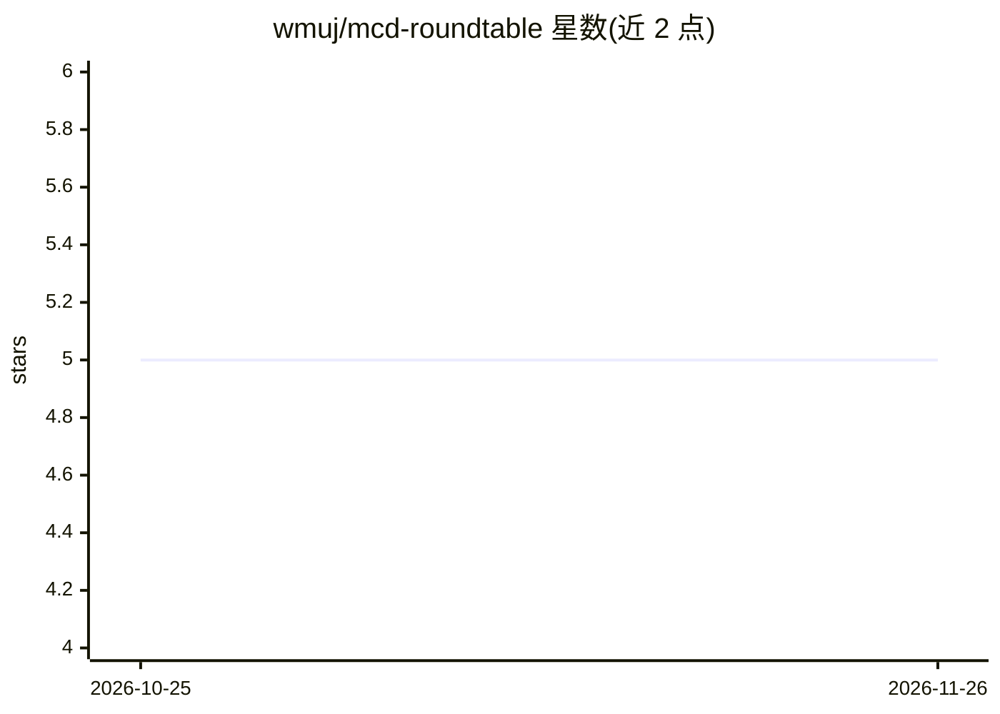

# wmuj/mcd-roundtable

⭐ 5 · JavaScript · MIT · 推送 2026-11-25 · [GitHub](https://github.com/wmuj/mcd-roundtable) · 个人维护 · 中文 README

**麦当劳用户：让三个 AI 军师用真实优惠券算出最优点餐组合**

基于麦当劳官方 MCP 的 CLI 工具：通过 MCP 接口读取实时菜单、门店、真实券包与营养数据，将算术下沉到确定性代码（0/1 背包求解预算内最优组合，无 LLM、结果可复现），再由精算师、营养师、干饭人三个 AI 角色围绕真实优化结果生成台词，并可生成 SVG 战报卡片嵌入 GitHub Profile。面向经常点麦当劳、想最大化用券的用户及关注 MCP+确定性优化器配合的开发者。仅读不下单，接入实时数据需自备 MCP Token。

## 筛选速览

| 维度 | 判定 | 备注 |
|---|---|---|
| AI 角色 | `ai-native` | 本体是模型或模型工具 |
| 许可风险 | `permissive` | MIT |
| 部署形态 | `library` | 以包/库形式分发 |
| 模型依赖 | — | README 未给出锁定关系 |
| 硬件要求 | — | 无带数字的原话,不猜 |
| 安装摩擦 | `low` | 无编译、无系统依赖或容器化 |
| 成熟度 | — | 结构信号不足 |

## 能力要点

- 通过麦当劳官方 MCP 读取实时菜单、券包与营养数据
- 0/1 背包确定性优化求解预算内最优组合，无 LLM 参与
- 三个 AI 军师台词由真实优化结果驱动
- 生成 SVG 战报卡片并支持 GitHub Action 每日自动更新

## 适用场景

- 预算内用真实优惠券算出最值的点餐组合
- 减脂期按蛋白质最大化筛选麦当劳餐品
- 给 GitHub Profile 配一张每日自动更新的战报卡片
- 参考 MCP 与确定性优化器配合的应用开发方式

## 场景标签

 · 领域:生活工具/AI 应用

## 证据(README 行号)

> L29: - **算术交给确定性代码** —— 0/1 背包求解预算内最优组合，无 LLM、无随机数，同输入必同输出，可复现、可审计；
> L30: - **吵架交给三军师** —— 精算师、营养师、干饭人围着这单饭各执一词，台词全部由真实优化结果驱动。
> L28: - **取数交给 麦当劳官方 MCP** —— 实时菜单、门店、你的真实券包、营养数据、核价接口，全部真数据；

## 星数曲线

2026-10-25 5 → 2026-11-26 5（+0）

---
*卡片 v1 · prompt 1.4 · 生成 2026-11-21 · 置信度 high · 依据 README sha `403a90b35e17` · [字段定义](../../DATASET.md)*
