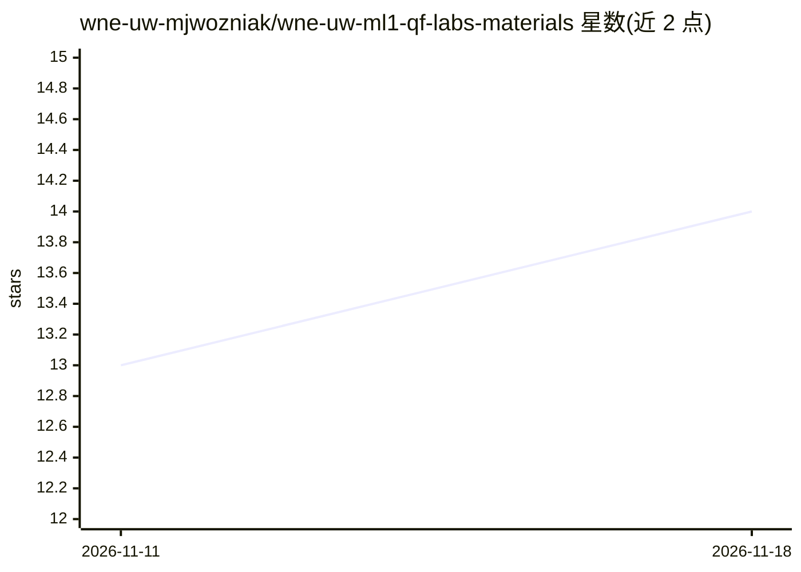

# wne-uw-mjwozniak/wne-uw-ml1-qf-labs-materials

⭐ 14 · Jupyter Notebook · 推送 2026-11-11 · [GitHub](https://github.com/wne-uw-mjwozniak/wne-uw-ml1-qf-labs-materials) · 组织维护

**华沙大学金融机器学习课程的实验 Notebook 教学材料**

华沙大学经济学院定量金融专业《Machine Learning in Finance I》课程的实验材料仓库：包含 Python 入门课程、EDA 与数据整理、线性/逻辑回归、KNN、SVM、决策树与随机森林等主题的 Jupyter Notebook，按理论讲解→从零实现→scikit-learn→交叉验证调参→完整流水线→作业的统一结构组织，配套 Kaggle 联赛竞赛（每期限定一个模型族）与 Kedro 项目结构自学教程。通过 uv 管理依赖，git clone 后 uv sync 即可运行 JupyterLab。

## 筛选速览

| 维度 | 判定 | 备注 |
|---|---|---|
| AI 角色 | `ai-knowledge` | 知识聚合/清单类 |
| 许可风险 | `none` | — |
| 部署形态 | `None` |  |
| 模型依赖 | — | README 未给出锁定关系 |
| 硬件要求 | — | 无带数字的原话,不猜 |
| 安装摩擦 | `low` | 无编译、无系统依赖或容器化 |
| 成熟度 | — | 结构信号不足 |

## 能力要点

- 9 个教学 Notebook，覆盖从 Python 基础到集成学习的完整课程路径
- 每个模型 Notebook 统一结构：理论→从零实现→scikit-learn→调参→完整流水线
- Kaggle League 竞赛框架：限定模型族、固定种子、MD5 校验可复现性
- 37 个练习的 Python 自学课程含隐藏答案与组合分析毕业项目

## 适用场景

- 学习金融场景下的机器学习课程实验内容
- 按竞赛规则参与限定模型族的 Kaggle 联赛
- 自学 Python 数据科学生态与 scikit-learn 工作流

## 场景标签

`金融量化` `教程课程` · 领域:学习与行业

## 证据(README 行号)

> L3: Lab notebooks for the **Machine Learning in Finance I** course (Quantitative Finance, Faculty of Economic Sciences, 
> L64: Every model notebook follows the same structure: theory → from-scratch implementation → scikit-learn → cross-valida

## 星数曲线

2026-11-11 13 → 2026-11-18 14（+1）

---
*卡片 v1 · prompt 1.4 · 生成 2026-11-18 · 置信度 high · 依据 README sha `98c47bc0dade` · [字段定义](../../DATASET.md)*
