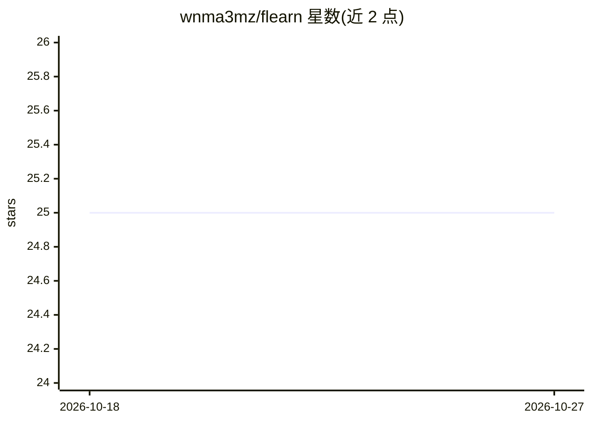

# wnma3mz/flearn

⭐ 25 · Python · Apache-2.0 · 推送 2026-03-29 · [GitHub](https://github.com/wnma3mz/flearn) · 个人维护 · 中文 README

**PyTorch 联邦学习框架：多策略聚合与客户端训练模拟**

基于 PyTorch 的联邦学习框架，实现 Server/Client 工作流：服务器下发训练、上传、接收、测试指令，客户端按配置的 Trainer 与 Strategy 完成本地训练与参数上传下载，服务器端聚合。收录 FedAVG、FedProx、SCAFFOLD、MOON、FedBN 等 20 余种论文策略，部分标注非官方实现或待测试；附知识蒸馏（Distiller）、通信加密、日志等辅助类。通过 pip 安装，附 MNIST/CIFAR 示例，split-learning 存在 loss 爆炸问题。

## 筛选速览

| 维度 | 判定 | 备注 |
|---|---|---|
| AI 角色 | `ai-ecosystem` | LLM/agent 周边工具 |
| 许可风险 | `permissive` | Apache-2.0 |
| 部署形态 | `library` | 以包/库形式分发 |
| 模型依赖 | — | README 未给出锁定关系 |
| 硬件要求 | — | 无带数字的原话,不猜 |
| 安装摩擦 | `low` | 无编译、无系统依赖或容器化 |
| 成熟度 | — | 结构信号不足 |

## 能力要点

- 收录 20 余种联邦学习策略（FedAVG/FedProx/SCAFFOLD/MOON/FedBN 等）
- Server/Client 六步工作流：训练、上传、聚合、下发、接收、测试
- Strategy 拆分为 client/server/client_revice 三个可定制函数
- 辅助类含知识蒸馏、通信参数编码、日志输出

## 适用场景

- 复现联邦学习论文中的聚合与训练策略
- 在 MNIST/CIFAR 上模拟多客户端联邦训练
- 研究非 IID 数据下的个性化联邦学习算法

## 场景标签

 · 领域:机器学习框架/联邦学习

## 证据(README 行号)

> L1: ## 联邦学习框架
> L92: 1. 服务器(Server)发送**训练指令**至各个客户端(Client)进行训练 (Server->Comm(S)->Comm(C)->Client)；模拟实验时，(Server->Client)
> L103: - Strategy其实可以分为Server和Client两个部分，其中Client有两个函数（上传和接收）。此处是将策略看作一个整体，即Client和Server都调用同一个Strategy

## 星数曲线

2026-10-18 25 → 2026-10-27 25（+0）

---
*卡片 v1 · prompt 1.4 · 生成 2026-10-26 · 置信度 high · 依据 README sha `adce6527aa17` · [字段定义](../../DATASET.md)*
