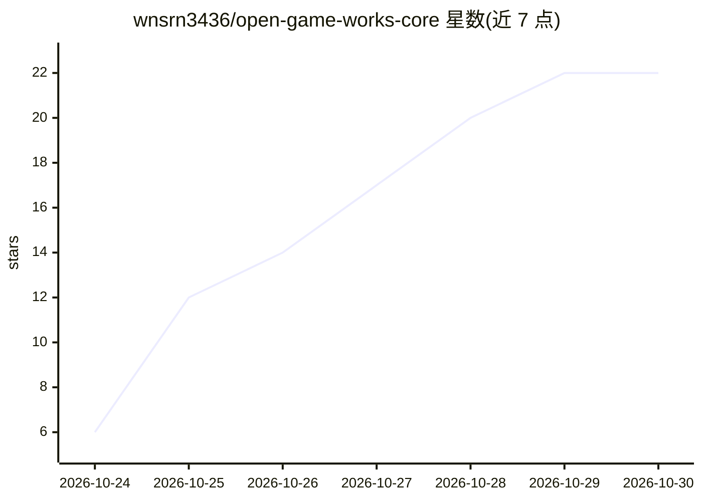

# wnsrn3436/open-game-works-core

⭐ 22 · TypeScript · Apache-2.0 · 推送 2026-10-29 · [GitHub](https://github.com/wnsrn3436/open-game-works-core) · 个人维护 · 中文 README

**让 AI agent 在预置 core 上开发商业级服务器-客户端游戏的 harness**

提供一套规则、技能与 core 模块规范，以及 CLI 工具 ogw：人类下达一条命令（如 create game），Claude Code 或 Codex 会话中的 lead agent 调度内容、试玩、评审等子 agent，循环编辑-游玩-评审直到产出游戏。基础设施、运营、商店合规、元系统预置为 core，agent 只写玩法内容代码。支持回归测试、UI 质量、全流程等自动化检查，可构建并部署到多平台。目前仅在 macOS Apple silicon 上测试过，build 命令尚未运行过，配置格式仍可能变化。

## 筛选速览

| 维度 | 判定 | 备注 |
|---|---|---|
| AI 角色 | `ai-ecosystem` | LLM/agent 周边工具 |
| 许可风险 | `permissive` | Apache-2.0 |
| 部署形态 | `self-host` | docker 或自建部署 |
| 模型依赖 | — | README 未给出锁定关系 |
| 硬件要求 | — | 无带数字的原话,不猜 |
| 安装摩擦 | `low` | 无编译、无系统依赖或容器化 |
| 成熟度 | `idea` | |

## 能力要点

- lead agent 调度子 agent 的编辑-游玩-评审开发循环，含盲测对比的评审 agent
- ogw CLI 承担无需判断的工作（设置读写、实例启动、任务调度）
- core 预置 infra、live ops、商店合规、元系统，agent 只写玩法内容代码
- 8 类自动化检查与多平台（android/ios/web/windows/macos/linux）构建部署

## 适用场景

- 用一条自然语言命令让 agent 开发一款服务器-客户端游戏
- 在预置 core 上迭代玩法并通过评审循环判断游戏是否达标
- 自动化完成游戏构建、加固与多环境部署

## 场景标签

`编码 Agent` `多智能体` · 领域:Agent 开发

## 证据(README 行号)

> L19: The features that many games would write again the same way (infra, live ops, store policy, meta systems) are prebu
> L21: This repository is the harness: the rules the agents follow, the skills and core module specs they read, the settin
> L25: open-game-works is under active development. So far it has been tested only on macOS, with Claude Code running Clau

## 星数曲线

2026-10-24 6 → 2026-10-30 22（+16）

---
*卡片 v1 · prompt 1.4 · 生成 2026-10-28 · 置信度 mid · 依据 README sha `858867bed2af` · [字段定义](../../DATASET.md)*
