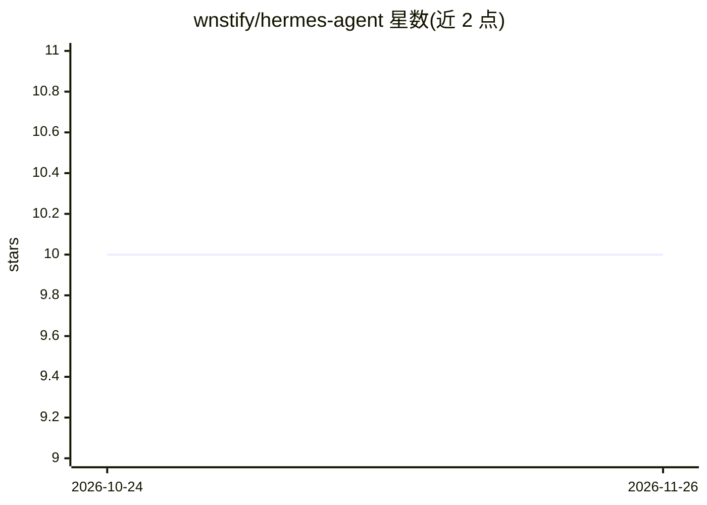

# wnstify/hermes-agent

⭐ 10 · Shell · 推送 2026-05-23 · [GitHub](https://github.com/wnstify/hermes-agent) · [官网](https://webnestify.cloud/insights/cybersecurity-hardening/hermes-agent-deployment/) · 组织维护

**企业自托管 AI Agent 技术栈的安全加固参考配置**

Webnestify 博客文章《安全 AI Agent 基础设施部署》的配套代码仓库，提供 Hermes Agent 与 Honcho 组合在企业服务器上运行的加固模式：沙箱执行容器（rootless Docker、cap_drop:[ALL]、资源限制、tmpfs）、SSH ForceCommand 入口（环境变量白名单）、以及 Honcho 自托管栈（API + Postgres/pgvector + Redis）的内网隔离配置。仓库本身不含 Agent 本体，需从上游安装，各文件需配合博客文章阅读并替换占位符。

## 筛选速览

| 维度 | 判定 | 备注 |
|---|---|---|
| AI 角色 | `ai-ecosystem` | LLM/agent 周边工具 |
| 许可风险 | `none` | — |
| 部署形态 | `None` |  |
| 模型依赖 | — | README 未给出锁定关系 |
| 硬件要求 | — | 无带数字的原话,不猜 |
| 安装摩擦 | `low` | 无编译、无系统依赖或容器化 |
| 成熟度 | — | 结构信号不足 |

## 能力要点

- 沙箱容器加固模式：rootless Docker、cap_drop:[ALL]、no-new-privileges、资源限额
- SSH ForceCommand 入口脚本，仅透传白名单环境变量
- Honcho 自托管栈（API + Postgres/pgvector + Redis + deriver worker）内网隔离与资源限制
- 可选替换为 Docker Hardened Images 签名基础镜像

## 适用场景

- 在公司自有服务器上部署 Hermes Agent 与 Honcho 时套用安全加固配置
- 为 Agent 沙箱执行环境做最小权限与资源耗尽防护
- 参考网关/沙箱分离的私有 Agent 基础设施架构设计

## 场景标签

 · 领域:AI Agent 基础设施/安全部署

## 证据(README 行号)

> L5: Hardening patterns for running an AI agent stack (Hermes Agent + Honcho) on company servers without exposing product
> L13: |`sandbox/compose.yml`|Hardened single-purpose execution container — rootless Docker, `cap_drop:[ALL]` with narrow 
> L42: - **The agent itself.** Install Hermes and Honcho from upstream:

## 星数曲线

2026-10-24 10 → 2026-11-26 10（+0）

---
*卡片 v1 · prompt 1.4 · 生成 2026-11-19 · 置信度 high · 依据 README sha `92890335b60c` · [字段定义](../../DATASET.md)*
