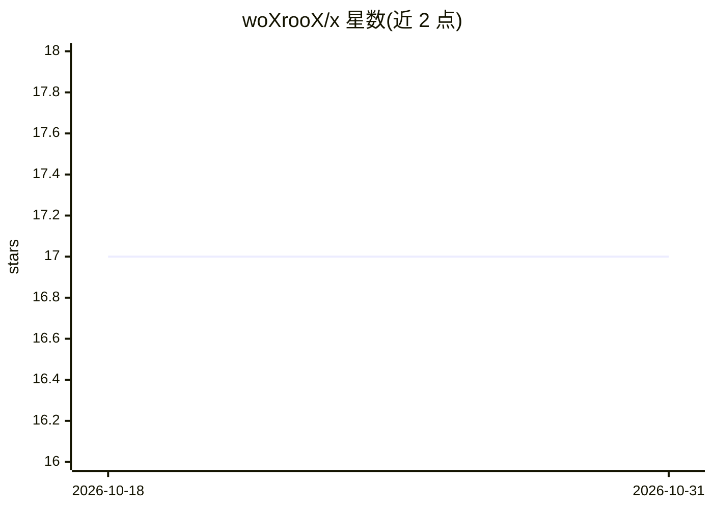

# woXrooX/x

⭐ 17 · JavaScript · NOASSERTION · 推送 2026-10-30 · [GitHub](https://github.com/woXrooX/x) · [官网](https://www.woXrooX.com/developer/tools/x) · 个人维护

**加速 Web 应用创建初始阶段的开发工具**

面向程序员的 Web 应用开发辅助软件，目标是省去项目初期搭建框架等重复性工作，让开发者直接进入创造性开发阶段。README 未给出具体技术机制或功能清单，仅提供落地页与文档页链接，说明功能详情、下载途径与使用教程均位于外部站点；落地页标注网站仍在开发中。涉及 API、CSS、数据库、Flask 等主题标签。

## 筛选速览

| 维度 | 判定 | 备注 |
|---|---|---|
| AI 角色 | `ai-enhanced` | 去掉 AI 部分产品仍成立 |
| 许可风险 | `none` | NOASSERTION |
| 部署形态 | `None` |  |
| 模型依赖 | — | README 未给出锁定关系 |
| 硬件要求 | — | 无带数字的原话,不猜 |
| 安装摩擦 | `low` | 无编译、无系统依赖或容器化 |
| 成熟度 | `idea` | |

## 能力要点

- 定位为跳过项目初始搭建阶段、加速 Web 应用创建的工具
- 功能详情与下载链接托管在外部落地页
- 提供独立文档页（含教程与 wiki 资源）

## 适用场景

- 快速开始新的 Web 应用项目，跳过框架搭建
- 查阅官方文档了解工具用法

## 场景标签

 · 领域:Web 开发工具

## 证据(README 行号)

> L2: As a seasoned programmer, We have noticed that the initial phase of a project can be tedious and time-consuming. Thi

## 星数曲线

2026-10-18 17 → 2026-10-31 17（+0）

---
*卡片 v1 · prompt 1.4 · 生成 2026-10-30 · 置信度 low · 依据 README sha `f352e90b70cb` · [字段定义](../../DATASET.md)*
