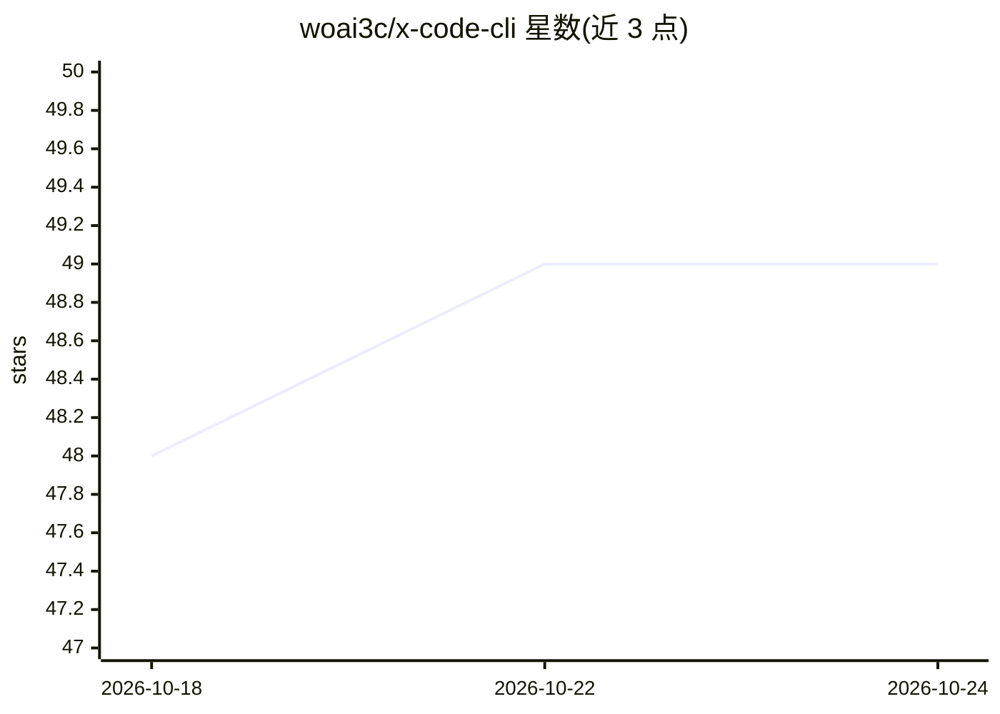

# woai3c/x-code-cli

⭐ 49 · TypeScript · MIT · 推送 2026-10-15 · [GitHub](https://github.com/woai3c/x-code-cli) · 个人维护 · 中文 README

**模型无关的编码 agent CLI，兼容 Claude Code 扩展生态**

开源命令行编码代理，支持通过 API key 或 ChatGPT 登录接入 Anthropic/OpenAI/DeepSeek/Google/阿里/xAI/智谱/Moonshot 等提供商，也可连接任意 OpenAI 兼容端点（vLLM/OpenRouter/内部网关）。运行时提供规划模式、5 个内置子代理、持久化目标循环（执行→验证→修复）、自动记忆、上下文压缩与 3 级权限模型。插件加载器兼容 Claude Code 的插件/技能/子代理/MCP/Hooks 约定。本地处理 PDF 与音频：音频经 whisper.cpp 本地转录，仅时间戳文本送入模型。限制：要求 Node.js >= 22；ChatGPT 令牌目前以明文文件存储于 ~/.x-code/auth/，系统密钥环存储未实现。

## 筛选速览

| 维度 | 判定 | 备注 |
|---|---|---|
| AI 角色 | `ai-ecosystem` | LLM/agent 周边工具 |
| 许可风险 | `permissive` | MIT |
| 部署形态 | `library` | 以包/库形式分发 |
| 模型依赖 | local-ok | 支持本地模型 |
| 硬件要求 | — | 无带数字的原话,不猜 |
| 安装摩擦 | `low` | 无编译、无系统依赖或容器化 |
| 成熟度 | — | 结构信号不足 |

## 能力要点

- 8 家提供商 API key 接入 + OpenAI 兼容端点逃生通道（custom:<model-id>）
- 兼容 Claude Code 插件/技能/子代理/MCP/Hooks 生态
- 5 个内置子代理与执行→验证→修复的持久化目标循环
- 音频经 whisper.cpp 本地转录，PDF 原始字节不上传

## 适用场景

- 在命令行中用任意模型进行代码解释、重构等编码任务
- 复用已有 Claude Code 插件与技能生态
- 通过 BYOK 与本地执行控制 agent 权限与数据边界

## 场景标签

`编码 Agent` · 领域:编码与开发

## 证据(README 行号)

> L14: **Model agnostic** — Switch providers at any time with `/model`, or connect any OpenAI-compatible endpoint. One wor
> L86: **OpenAI-compatible escape hatch** (vLLM / OpenRouter / internal gateways): set both `OPENAI_COMPATIBLE_API_KEY` an

## 星数曲线

2026-10-18 48 → 2026-10-24 49（+1）

---
*卡片 v1 · prompt 1.4 · 生成 2026-10-24 · 置信度 high · 依据 README sha `dffc4c7a65af` · [字段定义](../../DATASET.md)*
