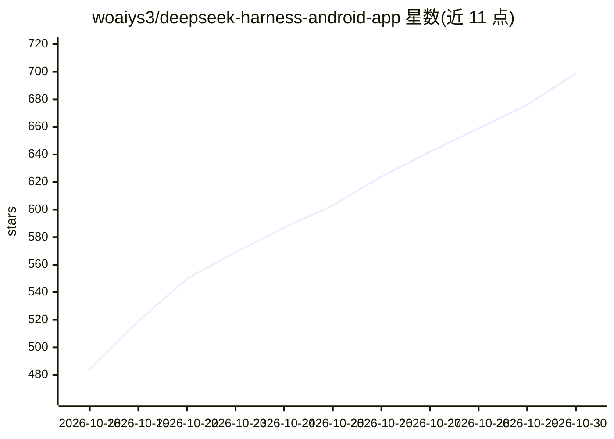

# woaiys3/deepseek-harness-android-app

⭐ 699 · Java · MIT · 推送 2026-10-18 · [GitHub](https://github.com/woaiys3/deepseek-harness-android-app) · [官网](https://dshaa.xin) · 个人维护 · 中文 README

**把 DeepSeek Harness 打包成 APK，让 AI 免 Root 操作安卓手机**

将 DeepSeek Harness（DSH）内核打包为可直接安装的 Android 应用：AI 通过特权（root/Shizuku）、无障碍、虚拟屏、AI 浏览器四条通道操作手机——装应用、点屏幕、改系统设置、截图、模拟输入、读屏与自动化网页操作。文件读写仅需「所有文件访问」权限即可使用；App 内置 Python 3.14 与 npm、支持插件生态与 RPC API，提供控制台、会话管理、内核自检与数据备份还原。提供正式版、Lite 共存版与内嵌 GeckoView 的兼容版三个 APK。API Key 仅存本机。

## 筛选速览

| 维度 | 判定 | 备注 |
|---|---|---|
| AI 角色 | `ai-native` | 本体是模型或模型工具 |
| 许可风险 | `permissive` | MIT |
| 部署形态 | `library` | 以包/库形式分发 |
| 模型依赖 | locked-api |  |
| 硬件要求 | — | 无带数字的原话,不猜 |
| 安装摩擦 | `low` | 无编译、无系统依赖或容器化 |
| 成熟度 | — | 结构信号不足 |

## 能力要点

- 免 Root：Shizuku/root 可选，文件操作仅需「所有文件访问」权限
- 五个自研插件：特权 shell、结构化系统操作、无障碍读屏、虚拟屏 vscreen、AI 浏览器（DOM 快照+稳定 ref）
- 内置完整 DSH 内核（插件生态+RPC API）、Python 3.14 与 npm/npx
- 控制台提供内核自检、会话回收站、备份导出/还原与主题自定义

## 适用场景

- 让 AI 代我装应用、点屏幕、改系统设置、模拟输入
- AI 在独立虚拟屏里跑自动化任务，主屏照常用
- 不装 Termux、不敲命令，手机上直接跑 DSH Agent 与插件

## 场景标签

`GUI 自动化` `浏览器自动化` · 领域:效率与自动化

## 证据(README 行号)

> L30: - 🔓 **免 Root 系统特权**：通过 Shizuku 打通系统 shell —— AI 能**装应用、点屏幕、改系统设置、截图、模拟输入**，这是"手机上的 AI Agent"，不只是聊天窗口
> L79: > 通过这五个插件，AI 不再只是"聊聊天"，而是能**真正控制你的手机**——特权通道（root/Shizuku）负责系统级操作，无障碍通道（无需授权）负责读屏与交互，虚拟屏通道让 AI 在**不打扰主屏**的前提下跑自动化任务

## 星数曲线

2026-10-18 484 → 2026-10-30 699（+215）

---
*卡片 v1 · prompt 1.4 · 生成 2026-10-21 · 置信度 mid · 依据 README sha `294e6a9a66db` · [字段定义](../../DATASET.md)*
