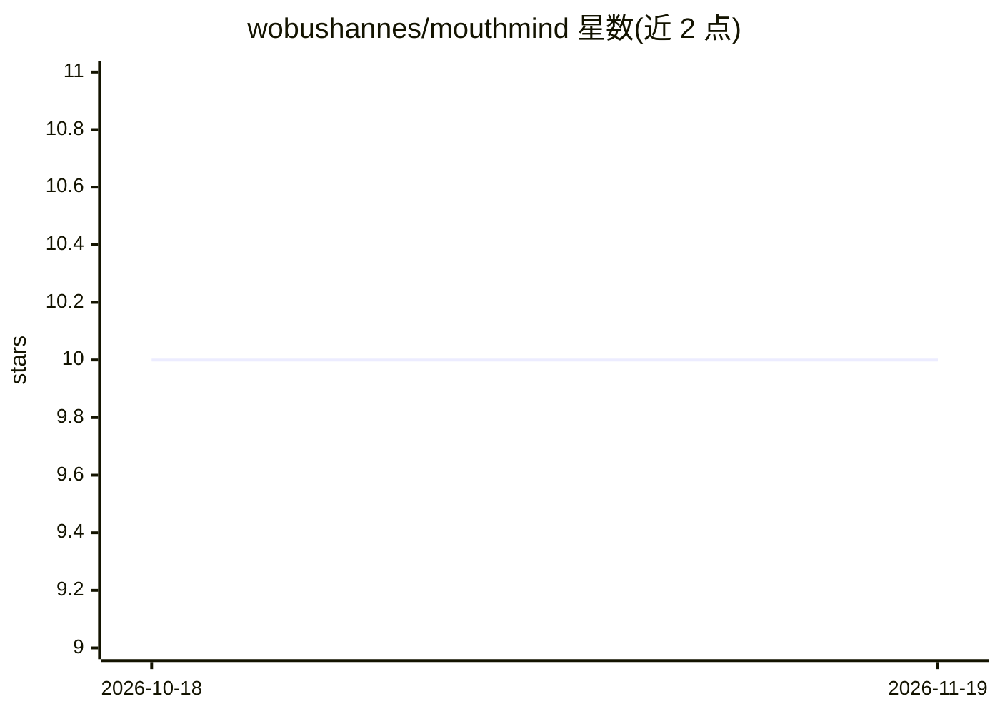

# wobushannes/mouthmind

⭐ 10 · 推送 2026-07-24 · [GitHub](https://github.com/wobushannes/mouthmind) · 个人维护

**从视频帧直接生成字符序列的视觉唇语识别研究框架**

MouthMind 是一个视觉语音识别（唇读）研究框架，将 VSR 视为序列到序列的字符生成问题：使用多视角融合架构与 Transformer 解码器，在无 teacher forcing 的条件下从视频帧直接生成字符序列。训练与推理仅使用 3D 面部关键点几何特征（不含音频、像素或频谱图），音频仅由 Whisper 等工具在数据标注阶段用于生成文本标签。基于作者此前构建的 237,025 段、1,121 名说话人的多语言网格数据集。注意：项目不公开代码、模型权重与训练数据，仅共享架构说明、训练日志与演示视频。

## 筛选速览

| 维度 | 判定 | 备注 |
|---|---|---|
| AI 角色 | `ai-native` | 本体是模型或模型工具 |
| 许可风险 | `none` | — |
| 部署形态 | `None` |  |
| 模型依赖 | — | README 未给出锁定关系 |
| 硬件要求 | — | 无带数字的原话,不猜 |
| 安装摩擦 | `low` | 无编译、无系统依赖或容器化 |
| 成熟度 | `idea` | |

## 能力要点

- 多视角融合编码器 + Transformer 解码器，无 teacher forcing 训练
- 仅以 3D 面部关键点几何特征为输入（无音频/像素/频谱图）
- 数据标注阶段用 Whisper 等 ASR 转录音频生成文本标签
- 报告 WER 0.24、CER 0.21、Letter Accuracy 80.3% 的训练结果

## 适用场景

- 从无声视频帧中识别说话内容的唇读研究
- 研究无 teacher forcing 的 Seq2Seq 训练范式
- 复用关键点几何表示做跨说话人/跨机位泛化实验

## 场景标签

`语音识别` · 领域:感知与多模态

## 证据(README 行号)

> L3: **A research framework for visual speech recognition — based on a multi-view Seq2Seq architecture without teacher fo
> L9: Using a **multi-view fusion architecture** and a **Transformer decoder**, the model learns to generate words directl
> L193: We share our research findings and insights openly — including the architecture, training approach, and results. H

## 星数曲线

2026-10-18 10 → 2026-11-19 10（+0）

---
*卡片 v1 · prompt 1.4 · 生成 2026-11-19 · 置信度 high · 依据 README sha `54d1b9dc6b3b` · [字段定义](../../DATASET.md)*
