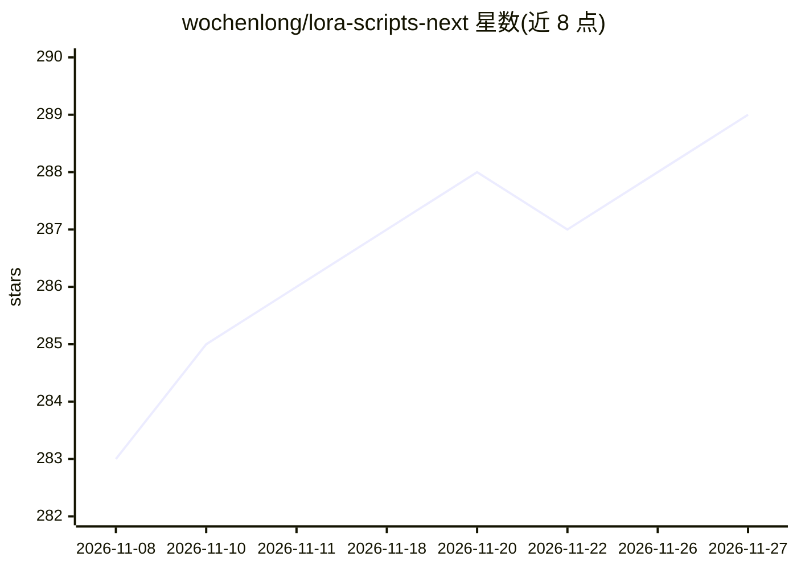

# wochenlong/lora-scripts-next

⭐ 289 · Python · AGPL-3.0 · 推送 2026-11-18 · [GitHub](https://github.com/wochenlong/lora-scripts-next) · 个人维护 · 中文 README

**给游戏角色/画风创作者的多引擎 LoRA 本地训练工作台**

本地运行的模型训练工作台：在统一界面中完成数据集准备、LoRA 训练与训练过程监控。3.3.0 起以多引擎工作台形式整合 Kohya、Anima Fast、Musubi、AI Toolkit、DiffSynth-Studio、KohakuMossTrainer 与 MOSS (anima_lora) 七种引擎，覆盖 MOSS-Image、Qwen-Image-2.1、Krea 2、Anima、SD 1.5、SDXL、Flux 等模型的 LoRA 入口。Windows 提供 lite 便携包（<2 GB，含 WD tagger 模型），Kohya 环境独立于主程序目录并可修复；源码方式支持 Windows/Linux，需 NVIDIA GPU。

## 筛选速览

| 维度 | 判定 | 备注 |
|---|---|---|
| AI 角色 | `ai-native` | 本体是模型或模型工具 |
| 许可风险 | `viral` | AGPL-3.0 |
| 部署形态 | `None` |  |
| 模型依赖 | — | README 未给出锁定关系 |
| 硬件要求 | — | 无带数字的原话,不猜 |
| 安装摩擦 | `low` | 无编译、无系统依赖或容器化 |
| 成熟度 | — | 结构信号不足 |

## 能力要点

- 统一界面整合 7 种训练引擎与模型/引擎兼容矩阵
- Kohya 运行时独立于 extensions/kohya/，主程序更新不卸载引擎
- lite 便携包内含 WD tagger 模型与离线 tokenizer 资产
- 提供 MOSS-Image、Qwen-Image-2.1 等多模型训练教程索引

## 适用场景

- 为游戏角色训练专属 LoRA 模型
- 在本地用不同引擎训练多种文生图模型的画风 LoRA
- 一站式管理数据集标注、训练任务与训练监控

## 场景标签

`微调` · 领域:训练与推理

## 证据(README 行号)

> L3:  A local training workbench for multiple models and engines
> L19: - **Multi-engine workbench:** Kohya, Anima Fast, Musubi, AI Toolkit, DiffSynth-Studio, and MOSS (`anima_lora`) are 
> L31: **Windows users:** download the current Next-Trainer-v3.3.1-dev-lite.7z, extract it, and use the included launcher.

## 星数曲线

2026-11-08 283 → 2026-11-27 289（+6）

---
*卡片 v1 · prompt 1.4 · 生成 2026-11-25 · 置信度 high · 依据 README sha `253aeaf68144` · [字段定义](../../DATASET.md)*
