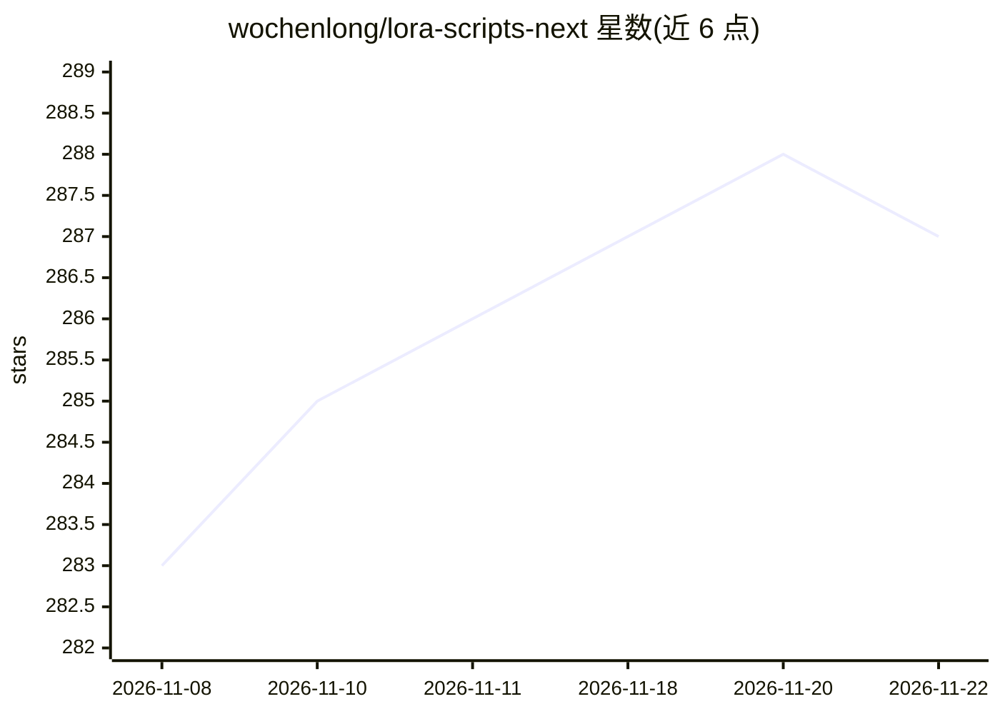

# wochenlong/lora-scripts-next

⭐ 287 · Python · AGPL-3.0 · 推送 2026-11-18 · [GitHub](https://github.com/wochenlong/lora-scripts-next) · 个人维护 · 中文 README

**多引擎 LoRA 本地训练工作台：一站式数据准备与模型训练**

面向 Windows/Linux 本地用户的图像模型 LoRA 训练 GUI 工作台，整合 Kohya、Anima Fast、Musubi、AI Toolkit、DiffSynth-Studio、MOSS (anima_lora) 六种训练引擎于统一界面，支持 MOSS-Image、Qwen-Image-2.1、Krea 2、SDXL、Flux 等模型的 LoRA 训练及部分全量微调。提供数据集准备、训练运行监控；Windows 有 2GB 内 lite 便携包，Kohya 引擎独立于主程序环境，更新不卸载用户已装的引擎。训练要求 NVIDIA GPU，各模型硬件需求随所选引擎而定。

## 筛选速览

| 维度 | 判定 | 备注 |
|---|---|---|
| AI 角色 | `ai-ecosystem` | LLM/agent 周边工具 |
| 许可风险 | `viral` | AGPL-3.0 |
| 部署形态 | `None` |  |
| 模型依赖 | — | README 未给出锁定关系 |
| 硬件要求 | — | 无带数字的原话,不猜 |
| 安装摩擦 | `low` | 无编译、无系统依赖或容器化 |
| 成熟度 | `idea` | |

## 能力要点

- 六种训练引擎（Kohya/Anima Fast/Musubi/AI Toolkit/DiffSynth-Studio/MOSS anima_lora）统一界面切换
- 覆盖 MOSS-Image、Qwen-Image-2.1、Krea 2、SDXL、Flux 等 9 类模型的 LoRA 训练矩阵
- Windows 提供 sub-2GB lite 便携包（含 WD tagger 模型与离线 tokenizer 资源）
- Kohya 引擎环境独立于 extensions/kohya/，主程序更新不影响引擎

## 适用场景

- 在本地为游戏角色与画风训练 LoRA 模型
- 在同一界面里为不同底模选择合适训练引擎而无需分别搭建环境
- 训练 MOSS-Image 或 Qwen-Image-2.1 的 LoRA 并跟踪训练运行

## 场景标签

`微调` · 领域:训练与推理

## 证据(README 行号)

> L3:  A local training workbench for multiple models and engines
> L19: - **Multi-engine workbench:** Kohya, Anima Fast, Musubi, AI Toolkit, DiffSynth-Studio, and MOSS (`anima_lora`) are 
> L62: **Kohya · Anima Fast · Musubi · AI Toolkit · DiffSynth-Studio · MOSS (anima_lora)**

## 星数曲线

2026-11-08 283 → 2026-11-22 287（+4）

---
*卡片 v1 · prompt 1.4 · 生成 2026-11-17 · 置信度 high · 依据 README sha `08368912d12d` · [字段定义](../../DATASET.md)*
