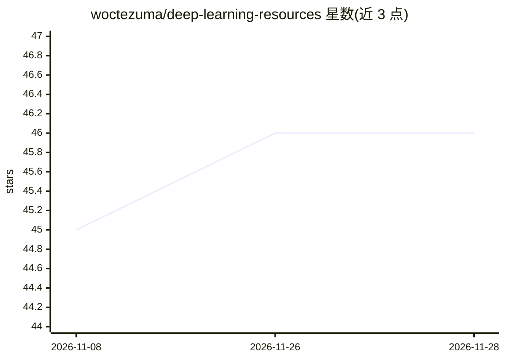

# woctezuma/deep-learning-resources

⭐ 46 · MIT · 推送 2026-11-07 · [GitHub](https://github.com/woctezuma/deep-learning-resources) · 个人维护

**深度学习书籍、课程、视频与博客的学习资源清单**

个人维护的深度学习学习资源聚合清单：以分类目录形式收录书籍（如 Understanding Deep Learning、Deep Learning 教科书、The Little Book of Deep Learning 等，多附 PDF 链接）、大学与机构课程（IP Paris、NYU DS-GA 1008、UC Berkeley Full-Stack DL、CS231n 等）、视频、外部资源与博客，附录收录 Python 资料及配套 Jupyter notebook 链接。条目附引用说明供读者按需查阅，面向自学者与从业者。

## 筛选速览

| 维度 | 判定 | 备注 |
|---|---|---|
| AI 角色 | `ai-knowledge` | 知识聚合/清单类 |
| 许可风险 | `permissive` | MIT |
| 部署形态 | `None` |  |
| 模型依赖 | — | README 未给出锁定关系 |
| 硬件要求 | — | 无带数字的原话,不猜 |
| 安装摩擦 | `low` | 无编译、无系统依赖或容器化 |
| 成熟度 | — | 结构信号不足 |

## 能力要点

- 按 Books/Courses/Videos/External resources/Blogs/Python 附录组织条目
- 收录 20+ 本深度学习与机器学习书籍，多数附免费 PDF 或 notebook 链接
- 收录多所大学与机构的深度学习课程（NYU、UC Berkeley、CS231n 等）

## 适用场景

- 系统查找深度学习入门与进阶书籍（含免费 PDF）
- 按学校或主题挑选深度学习在线课程
- 查找视频、博客等补充学习材料

## 场景标签

`精选清单` · 领域:学习与行业

## 证据(README 行号)

> L1: # Deep Learning Resources
> L3: 1. Books
> L10: ## Books
> L79: ## Courses

## 星数曲线

2026-11-08 45 → 2026-11-28 46（+1）

---
*卡片 v1 · prompt 1.4 · 生成 2026-11-18 · 置信度 high · 依据 README sha `f407246f1320` · [字段定义](../../DATASET.md)*
