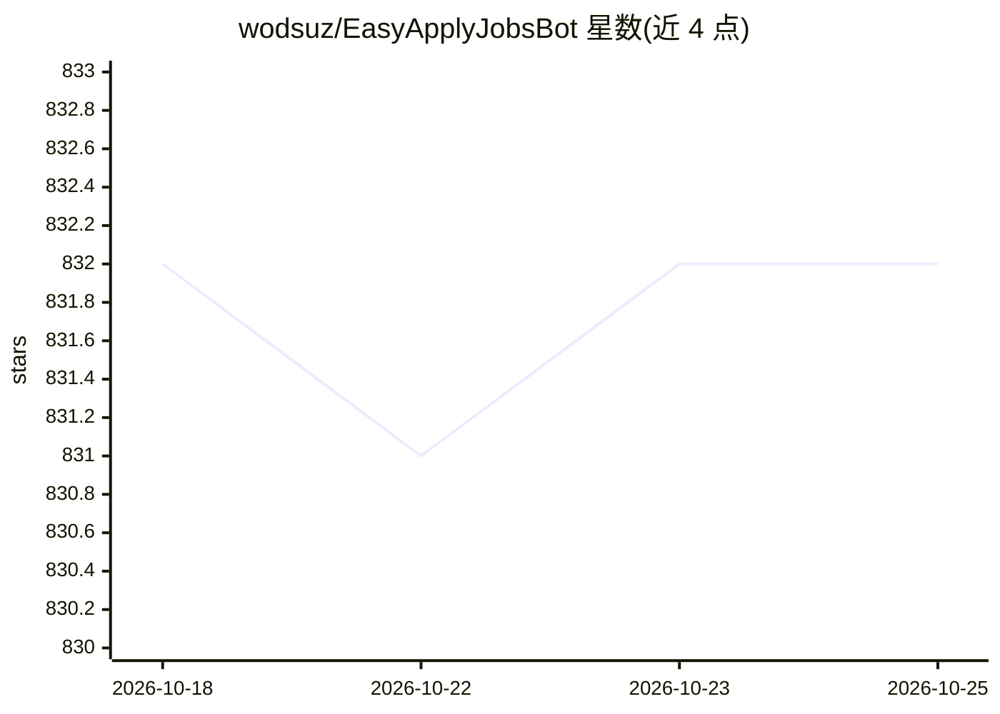

# wodsuz/EasyApplyJobsBot

⭐ 832 · Python · NOASSERTION · 推送 2026-05-18 · [GitHub](https://github.com/wodsuz/EasyApplyJobsBot) · [官网](https://www.apllie.com/en) · 个人维护

**自动投递 LinkedIn Easy Apply 职位的 Python 求职机器人**

基于 Selenium 的 Python 自动求职投递机器人：登录 LinkedIn 后按用户配置的关键词、地点、经验、薪资等偏好自动浏览并提交 Easy Apply 申请，未回答的附加问题可导出到 yaml 供下次复用；提供 dry-run 模拟模式与会话统计，结果输出 txt 文件。支持 Docker Compose 或手动 pip 安装运行，兼容 Chrome/Firefox（Firefox 限 Pro 版）。已并入 Apllie 商业生态，Pro 版含 AI 答题、headless 等付费功能。

## 筛选速览

| 维度 | 判定 | 备注 |
|---|---|---|
| AI 角色 | `ai-enhanced` | 去掉 AI 部分产品仍成立 |
| 许可风险 | `none` | NOASSERTION |
| 部署形态 | `self-host` | docker 或自建部署 |
| 模型依赖 | — | README 未给出锁定关系 |
| 硬件要求 | — | 无带数字的原话,不猜 |
| 安装摩擦 | `low` | 无编译、无系统依赖或容器化 |
| 成熟度 | — | 结构信号不足 |

## 能力要点

- 按关键词/地点/经验/薪资等偏好自动投递 LinkedIn Easy Apply 职位
- dry-run 模拟模式不点击最终提交按钮
- 未回答问题导出 yaml 并在后续投递中复用答案
- 提供 Docker Compose 与手动 pip 两种安装运行方式

## 适用场景

- 按我的偏好批量自动投递 LinkedIn Easy Apply 职位
- 先跑 dry-run 模拟确认投递行为再正式运行
- 把附加问题的答案沉淀下来加速后续申请

## 场景标签

`浏览器自动化` · 领域:效率与自动化

## 证据(README 行号)

> L7: A python bot to apply all Linkedin Easy Apply jobs based on your preferences.
> L62: - PRO FEATURE: Answer unasnwered questions with AI! Let AI answer easy apply jobs' questions.

## 星数曲线

2026-10-18 832 → 2026-10-25 832（+0）

---
*卡片 v1 · prompt 1.4 · 生成 2026-10-21 · 置信度 mid · 依据 README sha `75fdb34daf63` · [字段定义](../../DATASET.md)*
