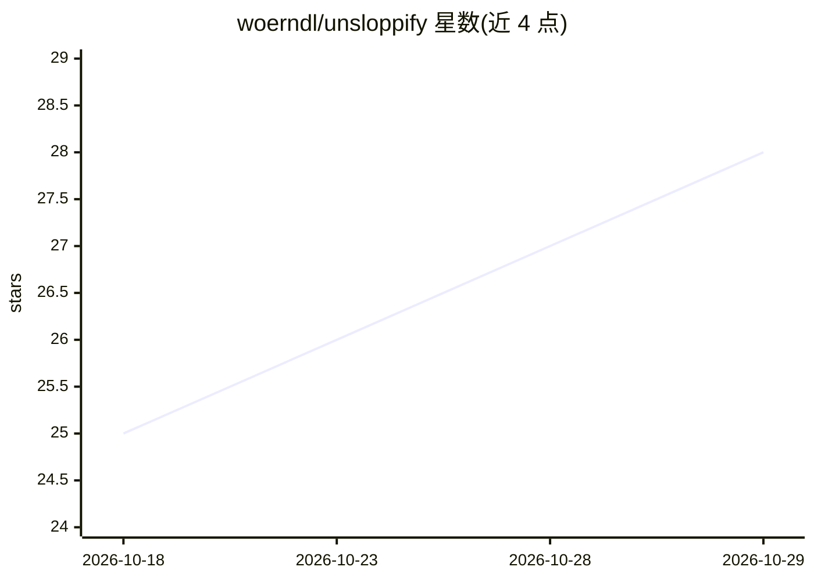

# woerndl/unsloppify

⭐ 28 · Shell · NOASSERTION · 推送 2026-10-23 · [GitHub](https://github.com/woerndl/unsloppify) · 个人维护

**清除 AI 写作腔调的 agent skill：两层文本去味规则库**

面向 Claude Code、Codex 等支持 skills 格式工具的写作清理技能。分两层：常驻 baseline 块粘贴进 CLAUDE.md/AGENTS.md 持续生效且 token 占用少；按需加载的 skill 层运行完整管线，包括六类失败模式测试、上下文规则、模式目录与确定性短语扫描器（scripts/scan.sh，基于 rg/grep -E）。两类按文本本身评判，无论人或模型所写均可处理，且明确声明不是 AI 署名检测器。通过 npx skills 安装，模式可编辑。

## 筛选速览

| 维度 | 判定 | 备注 |
|---|---|---|
| AI 角色 | `ai-ecosystem` | LLM/agent 周边工具 |
| 许可风险 | `none` | NOASSERTION |
| 部署形态 | `library` | 以包/库形式分发 |
| 模型依赖 | — | README 未给出锁定关系 |
| 硬件要求 | — | 无带数字的原话,不猜 |
| 安装摩擦 | `low` | 无编译、无系统依赖或容器化 |
| 成熟度 | — | 结构信号不足 |

## 能力要点

- 两层结构：常驻 baseline 块 + 按需加载的完整 skill 管线
- 六类失败模式（重要性膨胀、虚构张力、表演性措辞等）各配测试、禁用表与重写示例
- scripts/scan.sh 确定性短语扫描器，优先用 rg、回退 grep -E
- 模式来源逐条署名并标注许可（MIT 项目本体）

## 适用场景

- 让 coding agent 起草的长文减少 AI 写作痕迹
- 发布前对文档做短语级与结构级去味审计
- 自行编辑模式目录定制团队的写作禁用表

## 场景标签

`AI 写作` · 领域:内容生成

## 证据(README 行号)

> L10: Removes AI writing tells from any generated text. It has two tiers, one always on and one on demand.
> L18: Requires `skills` (`vercel-labs/skills`). Works with any tool that reads the skills format, including Claude Code a

## 星数曲线

2026-10-18 25 → 2026-10-29 28（+3）

---
*卡片 v1 · prompt 1.4 · 生成 2026-10-26 · 置信度 high · 依据 README sha `0c39bee767fe` · [字段定义](../../DATASET.md)*
