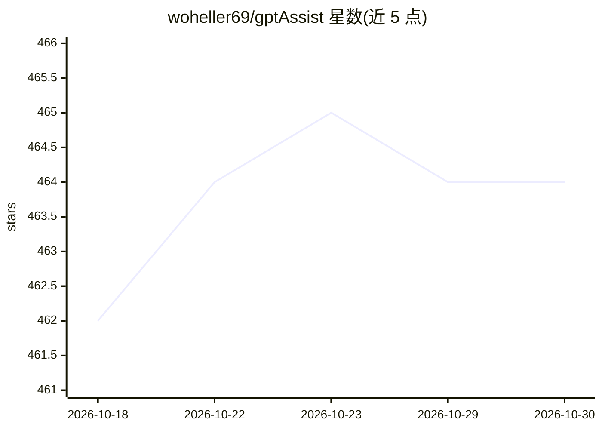

# woheller69/gptAssist

⭐ 464 · Java · GPL-3.0 · 推送 2026-05-19 · [GitHub](https://github.com/woheller69/gptAssist) · 个人维护

**Android 上的 ChatGPT WebView 轻量封装应用**

面向 Android 用户的 ChatGPT 网页封装客户端：以 WebView 加载 ChatGPT，默认屏蔽非必要 URL 与跟踪，可在右上角按钮切换受限/不受限模式；支持文件上传、语音输入。不支持通过 Apple/Microsoft/Google 账号登录，需先用浏览器完成注册。通过 F-Droid 分发，GPLv3 许可。README 顶部声明：因 Google 即将要求提交开发者个人身份信息，2026/2027 年后此应用将无法在认证 Android 设备上运行。

## 筛选速览

| 维度 | 判定 | 备注 |
|---|---|---|
| AI 角色 | `ai-ecosystem` | LLM/agent 周边工具 |
| 许可风险 | `viral` | GPL-3.0 |
| 部署形态 | `None` |  |
| 模型依赖 | — | README 未给出锁定关系 |
| 硬件要求 | — | 无带数字的原话,不猜 |
| 安装摩擦 | `low` | 无编译、无系统依赖或容器化 |
| 成熟度 | — | 结构信号不足 |

## 能力要点

- WebView 加载 ChatGPT 并屏蔽非必要 URL 与跟踪
- 可切换受限/不受限屏蔽模式
- 支持文件上传与语音输入
- 通过 F-Droid 分发，GPLv3 许可

## 适用场景

- 在 Android 上以精简界面使用 ChatGPT
- 屏蔽非必要网络请求、减少跟踪的对话体验

## 场景标签

`聊天机器人` · 领域:对话与助手

## 证据(README 行号)

> L32: gptAssist is a simple WebView wrapper for ChatGPT. It blocks all URLs which are not essential.
> L36: - 🔒 **Privacy-focused**: Blocks unnecessary URLs and tracking

## 星数曲线

2026-10-18 462 → 2026-10-30 464（+2）

---
*卡片 v1 · prompt 1.4 · 生成 2026-10-21 · 置信度 high · 依据 README sha `96bd02386065` · [字段定义](../../DATASET.md)*
