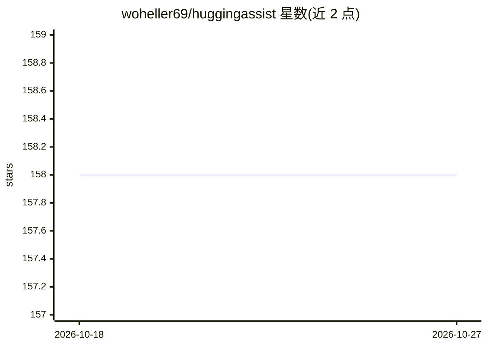

# woheller69/huggingassist

⭐ 158 · Java · GPL-3.0 · 推送 2025-11-03 · [GitHub](https://github.com/woheller69/huggingassist) · 个人维护

**Android 上访问 HuggingChat 的 WebView 封装应用**

以 WebView 封装方式在 Android 上加载 HuggingChat 网页，并屏蔽非功能必需的 URL；初始注册需使用外部浏览器完成。通过 F-Droid 分发，采用 GPLv3 许可证，由个人开发者维护。README 声明因 Google 将于 2026/2027 起要求开发者提交个人身份信息，该应用届时将无法在认证 Android 设备上继续使用。

## 筛选速览

| 维度 | 判定 | 备注 |
|---|---|---|
| AI 角色 | `ai-ecosystem` | LLM/agent 周边工具 |
| 许可风险 | `viral` | GPL-3.0 |
| 部署形态 | `None` |  |
| 模型依赖 | — | README 未给出锁定关系 |
| 硬件要求 | — | 无带数字的原话,不猜 |
| 安装摩擦 | `low` | 无编译、无系统依赖或容器化 |
| 成熟度 | — | 结构信号不足 |

## 能力要点

- WebView 封装 HuggingChat 并屏蔽非必需 URL
- 通过 F-Droid 分发，GPLv3 许可证
- README 声明 2026/2027 后不再支持认证 Android 设备

## 适用场景

- 在 Android 设备上使用 HuggingChat 对话
- 通过 F-Droid 获取开源 Android AI 聊天客户端

## 场景标签

`聊天机器人` · 领域:对话与助手

## 证据(README 行号)

> L16: huggingAssist is a simple WebView wrapper for huggingChat.
> L17: It blocks all URLs that are not essential for functioning.

## 星数曲线

2026-10-18 158 → 2026-10-27 158（+0）

---
*卡片 v1 · prompt 1.4 · 生成 2026-10-22 · 置信度 high · 依据 README sha `2408158386d8` · [字段定义](../../DATASET.md)*
