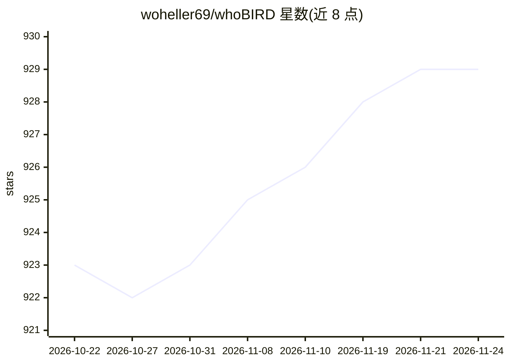

# woheller69/whoBIRD

⭐ 929 · Kotlin · GPL-3.0 · 推送 2026-11-20 · [GitHub](https://github.com/woheller69/whoBIRD) · 个人维护

**离线实时识别鸟鸣的 Android 应用（BirdNET 模型）**

whoBIRD 是基于 BirdNET 项目的 Android 应用，可在设备本地实时识别 6,000 余种鸟类的鸣声，无需联网。首次启动时下载 BirdNET 模型文件，之后持续监听并分析音频，检测结果记录于数据库，可备份、分享或删除。提供阈值调整、高通滤波、音频源选择、忽略日期地点的元模型开关、加权元模型（改善候鸟检测）以及保存 .wav 录音等选项。通过 F-Droid 分发。

## 筛选速览

| 维度 | 判定 | 备注 |
|---|---|---|
| AI 角色 | `ai-native` | 本体是模型或模型工具 |
| 许可风险 | `viral` | GPL-3.0 |
| 部署形态 | `None` |  |
| 模型依赖 | — | README 未给出锁定关系 |
| 硬件要求 | — | 无带数字的原话,不猜 |
| 安装摩擦 | `low` | 无编译、无系统依赖或容器化 |
| 成熟度 | — | 结构信号不足 |

## 能力要点

- 基于 BirdNET 模型，本地实时识别 6,000+ 鸟种，无需联网
- 加权元模型：当前周与全年各周预测的 50/50 加权，改善候鸟检测
- 可调检测阈值、高通滤波与音频输入源
- 检测记录数据库支持备份、分享、删除，可保存 .wav 录音

## 适用场景

- 野外观鸟时实时识别周围鸟鸣
- 离线环境下分析其他地点的鸟类录音
- 记录并管理个人观鸟检测记录数据库

## 场景标签

 · 领域:移动应用/生物声音识别

## 证据(README 行号)

> L16: Introducing whoBIRD, the ultimate birding companion that can recognize birds by their sounds, anywhere in the world
> L20: What's more, whoBIRD performs its magic in real time entirely on your device, without requiring an internet connect
> L29: At first start the app will download the required BirdNET model files.

## 星数曲线

2026-10-22 923 → 2026-11-24 929（+6）

---
*卡片 v1 · prompt 1.4 · 生成 2026-11-24 · 置信度 high · 依据 README sha `1c8ae9bd88f8` · [字段定义](../../DATASET.md)*
