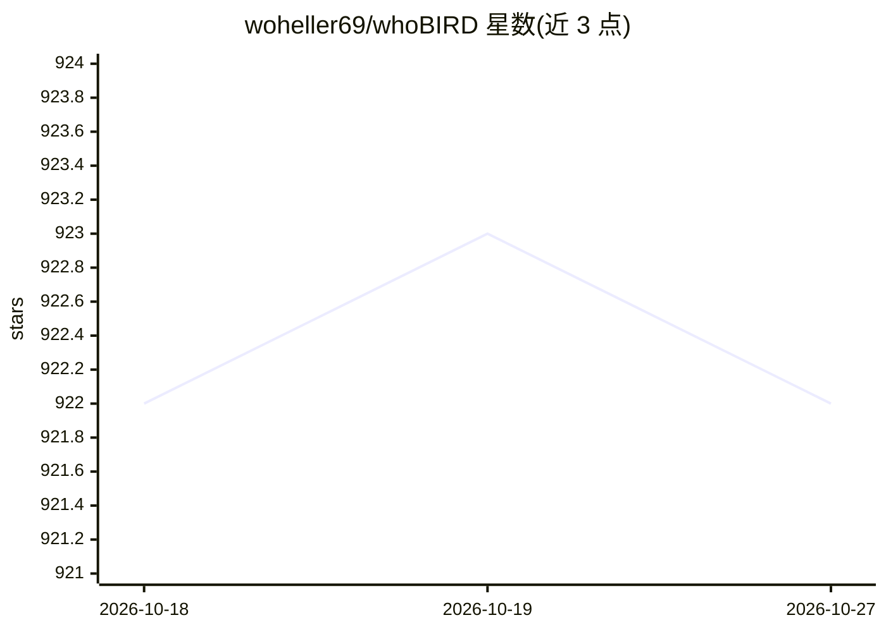

# woheller69/whoBIRD

⭐ 922 · Kotlin · GPL-3.0 · 推送 2026-08-02 · [GitHub](https://github.com/woheller69/whoBIRD) · 个人维护

**安卓实时鸟鸣识别应用，覆盖 6000+ 鸟种**

Android 端鸟鸣识别应用，基于 BirdNET 模型实时识别全球 6,000 余种鸟类的声音，全部推理在设备本地完成，无需联网。首次启动时下载 BirdNET 模型文件，之后自动监听分析；检测结果可查看、备份、分享或删除。提供元模型（按地点与日期校验物种出现可能性，支持全年加权模式）、高通滤波、概率阈值、音频源选择、保存 .wav 录音（需 Android 12+）等选项。通过 F-Droid 分发，GPLv3 许可。

## 筛选速览

| 维度 | 判定 | 备注 |
|---|---|---|
| AI 角色 | `ai-native` | 本体是模型或模型工具 |
| 许可风险 | `viral` | GPL-3.0 |
| 部署形态 | `None` |  |
| 模型依赖 | — | README 未给出锁定关系 |
| 硬件要求 | — | 无带数字的原话,不猜 |
| 安装摩擦 | `low` | 无编译、无系统依赖或容器化 |
| 成熟度 | — | 结构信号不足 |

## 能力要点

- 基于 BirdNET 模型实时识别 6,000+ 鸟种
- 推理完全在设备本地运行，无需联网
- 地点/日期元模型校验与全年 50/50 加权模式
- 检测记录数据库备份/分享，可保存 .wav 录音

## 适用场景

- 野外观鸟时实时听声辨鸟
- 离线环境下（森林、偏远地区）识别鸟鸣
- 记录并整理观鸟观察数据库

## 场景标签

 · 领域:移动应用/生物声学识别

## 证据(README 行号)

> L16: Introducing whoBIRD, the ultimate birding companion that can recognize birds by their sounds, anywhere in the world
> L20: What's more, whoBIRD performs its magic in real time entirely on your device, without requiring an internet connect

## 星数曲线

2026-10-18 922 → 2026-10-27 922（+0）

---
*卡片 v1 · prompt 1.4 · 生成 2026-10-21 · 置信度 high · 依据 README sha `7a13261ba8bc` · [字段定义](../../DATASET.md)*
