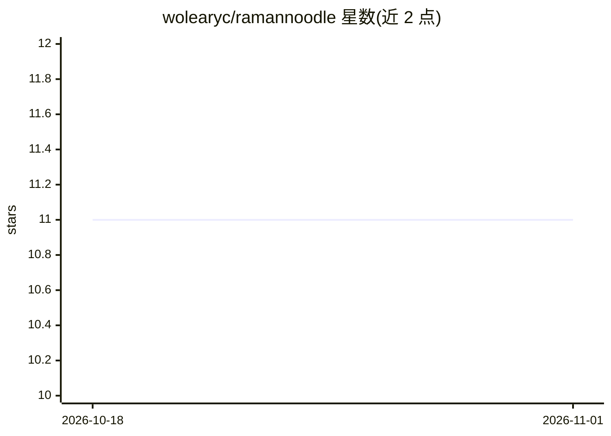

# wolearyc/ramannoodle

⭐ 11 · Python · MIT · 推送 2026-10-12 · [GitHub](https://github.com/wolearyc/ramannoodle) · [官网](https://ramannoodle.readthedocs.io) · 个人维护

**从第一性原理计算高效计算拉曼光谱的 Python API**

Ramannoodle 是用于从第一性原理计算结果计算拉曼光谱的 Python 库，支持分子动力学与声子两条计算路径，内置 VASP 接口，也可经 pymatgen、ase 等外部库的 IO 适配其他计算代码。核心机制是 PolarizabilityModel，通过多项式模型与机器学习模型减少所需的第一性原理极化率计算数量；机器学习模块基于 PyTorch 实现（需额外安装 torch-scatter/torch-sparse，用 ramannoodle[torch] 可选组安装）。以面向对象 API 提供，附 readthedocs 文档。

## 筛选速览

| 维度 | 判定 | 备注 |
|---|---|---|
| AI 角色 | `ai-native` | 本体是模型或模型工具 |
| 许可风险 | `permissive` | MIT |
| 部署形态 | `library` | 以包/库形式分发 |
| 模型依赖 | — | README 未给出锁定关系 |
| 硬件要求 | — | 无带数字的原话,不猜 |
| 安装摩擦 | `low` | 无编译、无系统依赖或容器化 |
| 成熟度 | — | 结构信号不足 |

## 能力要点

- 支持分子动力学与声子两种拉曼光谱计算路径
- PolarizabilityModel 通过多项式/机器学习模型减少第一性原理极化率计算量
- 内置 VASP 接口，可经 pymatgen/ase 扩展到其他计算代码
- 机器学习模块基于 PyTorch（图神经网络相关依赖 torch-scatter/torch-sparse）

## 适用场景

- 在 VASP 计算结果基础上预测材料拉曼光谱
- 利用机器学习模型降低极化率计算的成本
- 分析分子动力学轨迹或声子数据得到拉曼光谱

## 场景标签

 · 领域:计算材料学/光谱学

## 证据(README 行号)

> L5: **Ramannoodle** is a Python API for efficiently calculating Raman spectra from first principles calculations. Ramann
> L11:  Ramannoodle provides `PolarizabilityModel`'s to reduce the required number of first-principles polarizability calc
> L29: Ramannoodle's machine learning modules are implemented with PyTorch. To use these modules:

## 星数曲线

2026-10-18 11 → 2026-11-01 11（+0）

---
*卡片 v1 · prompt 1.4 · 生成 2026-11-01 · 置信度 high · 依据 README sha `9b3b654bd1aa` · [字段定义](../../DATASET.md)*
