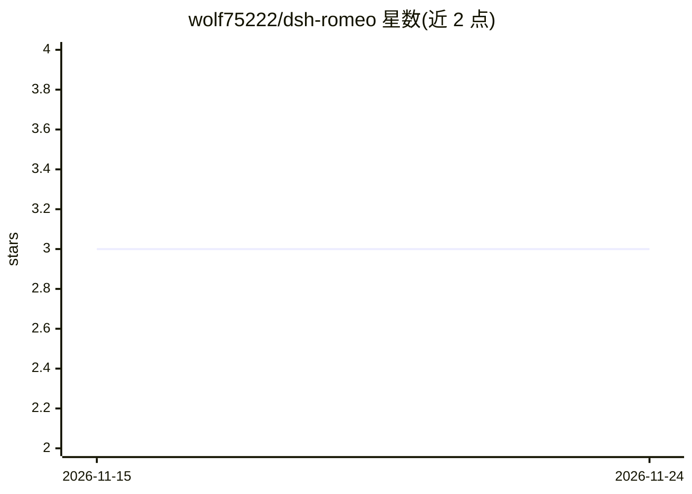

# wolf75222/dsh-romeo

⭐ 3 · JavaScript · MIT · 推送 2026-11-11 · [GitHub](https://github.com/wolf75222/dsh-romeo) · 个人维护

**一条命令在 ROMEO 超算上启动 DeepSeek/Kimi 并接入 dsh 编码代理**

在本地 macOS/Linux 电脑与 ROMEO 集群 GPU 之间建立通路的启动工具：通过 Slurm 作业在集群上以 vllm 启动 DeepSeek-V4.1-Flash-1017 或 Kimi-K3.1-Pro，开 SSH 隧道后在本机浏览器打开 DeepSeek Harness (dsh) 编码代理。提供作业状态查询、排队预估、实时监控、用量/历史统计、模型切换、诊断修复与作业停止等子命令；同一端点也可服务 opencode、Codex、Aider 等其他客户端。运行依赖本机 Node.js 20+ 与免密 SSH 登录 ROMEO，模型作业消耗项目 GPU 小时。

## 筛选速览

| 维度 | 判定 | 备注 |
|---|---|---|
| AI 角色 | `ai-ecosystem` | LLM/agent 周边工具 |
| 许可风险 | `permissive` | MIT |
| 部署形态 | `None` |  |
| 模型依赖 | locked-api |  |
| 硬件要求 | — | 无带数字的原话,不猜 |
| 安装摩擦 | `low` | 无编译、无系统依赖或容器化 |
| 成熟度 | — | 结构信号不足 |

## 能力要点

- 一条命令完成模型启动、隧道建立与 dsh 打开
- 支持 Kimi 跑代理、DeepSeek 跑子代理的组合（--models kimi+deepseek）
- 同一端点可服务 opencode、Codex、Claude Code、Aider 等客户端
- 提供排队预估、实时 tokens/s 监控与 GPU 用量统计

## 适用场景

- 在有 ROMEO 集群权限的项目里跑编码代理
- 为本地编辑器或多个编码客户端提供模型端点
- 查看集群作业排队原因与 GPU 小时消耗

## 场景标签

`编码 Agent` · 领域:编码与开发

## 证据(README 行号)

> L3: DeepSeek Harness (dsh), DeepSeek's coding agent, on your computer, with DeepSeek-V4.1-Flash-1017 or Kimi-K3.1-Pro ru
> L23: |`dsh-romeo --launch`|starts the model on ROMEO, waits until it answers (about 10 min), opens dsh in your browser|

## 星数曲线

2026-11-15 3 → 2026-11-24 3（+0）

---
*卡片 v1 · prompt 1.4 · 生成 2026-11-21 · 置信度 high · 依据 README sha `9882e3c554e9` · [字段定义](../../DATASET.md)*
