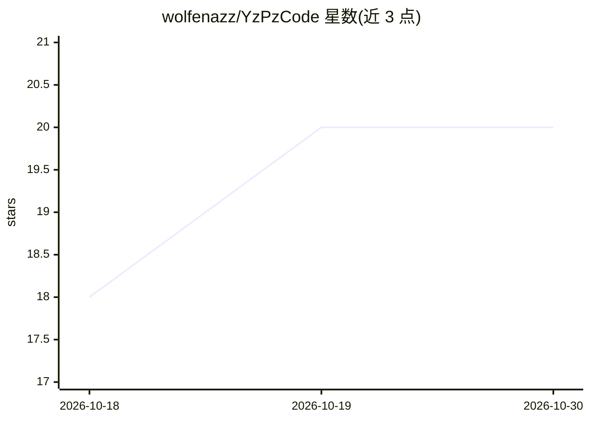

# wolfenazz/YzPzCode

⭐ 20 · TypeScript · Apache-2.0 · 推送 2026-10-29 · [GitHub](https://github.com/wolfenazz/YzPzCode) · [官网](www.yzpzcode.site) · 个人维护

**面向 AI 编码代理的统一原生工作区：终端网格、扩展、文档与设备窗口集成**

原生桌面工作区应用，将 AI 辅助开发所需的多窗口工作流整合到单一界面：并排 PTY 终端网格中检测、启动并管理 26 个外部 AI 编码 CLI（Claude Code、Codex、Antigravity 等），通过 PTY 桥接集成，声明与各厂商无隶属关系。另提供 14 个图形化编码助手扩展（运行在验证过的 VSCodium reh-web 沙箱运行时中，无需安装 VS Code 或 Node）、写作/演示/表格三个文档 Studio（经已安装的 CLI 无头运行 AI）、Android/iOS 设备窗口、内置浏览器与可视化检查器、本地语音朗读。Run & build 自动检测 15+ 生态系统。Arabic 等 RTL 语言支持为文档 Studio 的一等功能。面向使用多个 AI 编码代理的开发者。README 声明项目处于活跃开发中，功能可能为实验性。

## 筛选速览

| 维度 | 判定 | 备注 |
|---|---|---|
| AI 角色 | `ai-ecosystem` | LLM/agent 周边工具 |
| 许可风险 | `permissive` | Apache-2.0 |
| 部署形态 | `desktop` | 安装包/桌面程序 |
| 模型依赖 | — | README 未给出锁定关系 |
| 硬件要求 | — | 无带数字的原话,不猜 |
| 安装摩擦 | `high` | 编译与系统依赖俱全 |
| 成熟度 | `idea` | |

## 能力要点

- 检测并管理 26 个外部 AI 编码 CLI 的 PTY 会话
- 图形化扩展运行在带 SHA-256 校验的托管 VSCodium 运行时沙箱中
- 写作/演示 Studio 通过已安装 CLI 无头运行，支持 RTL 语言与约 150 种字体
- 内嵌 Android 模拟器与 iOS 模拟器窗口，支持 Flutter 热重载

## 适用场景

- 在单一窗口中并排运行多个 AI 编码代理终端会话
- 把图形化编码助手扩展与终端、编辑器放在同一网格中工作
- 用已安装的 AI CLI 生成报告与演示文稿，无需额外 IDE
- 在桌面工作区内直接预览和调试移动端应用

## 场景标签

 · 领域:开发工具/AI 代理工作区

## 证据(README 行号)

> L62:  26 AI coding CLIs
> L91: YzPzCode detects, launches and manages PTY sessions for 26 external AI coding agents. The core integrations:
> L170: - 📦 **Zero-config managed runtime**: a verified VSCodium `reh-web` runtime is provisioned with pinned SHA-256 dige

## 星数曲线

2026-10-18 18 → 2026-10-30 20（+2）

---
*卡片 v1 · prompt 1.4 · 生成 2026-10-28 · 置信度 mid · 依据 README sha `d664680c6b7a` · [字段定义](../../DATASET.md)*
