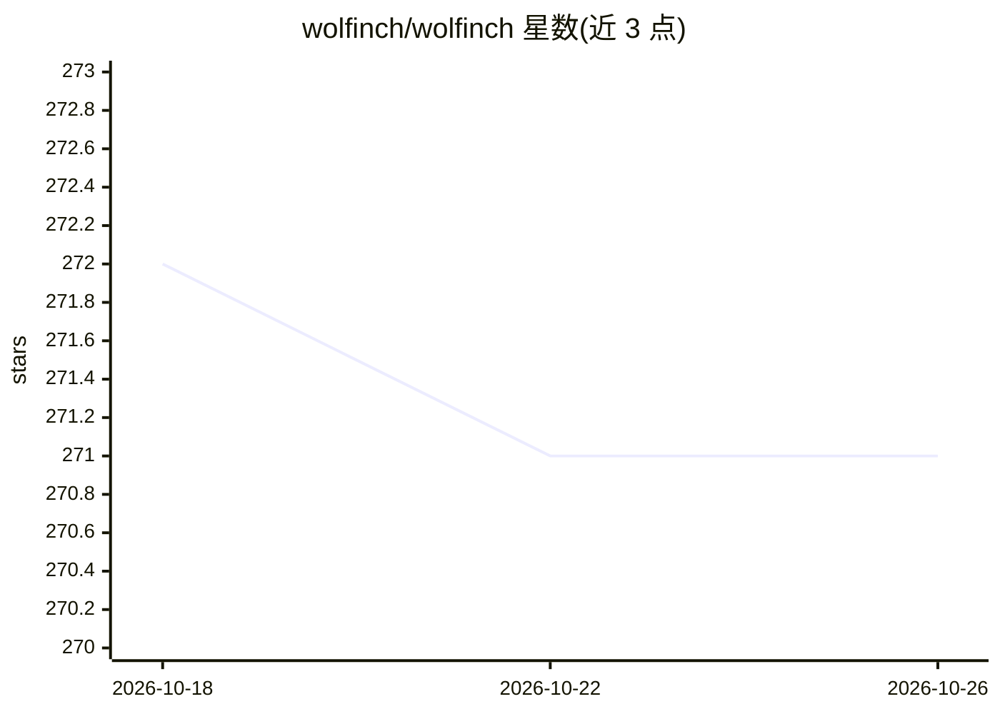

# wolfinch/wolfinch

⭐ 271 · Python · GPL-3.0 · 推送 2026-05-04 · [GitHub](https://github.com/wolfinch/wolfinch) · [官网](https://www.wolfinch.com) · 个人维护

**Python 算法交易机器人：支持股票与加密货币交易所**

用 Python 实现的交易机器人，面向算法交易用户，支持股票市场与多家加密货币交易所（Coinbase Pro、Binance、Robinhood 等）。采用模块化设计，可插拔扩展策略、指标与交易所。功能包括自动/手动交易、回测、纸面交易模拟、遗传优化器调参，以及可选的机器学习模式（训练与使用 ML 决策引擎）。多交易所多交易对可并行，支持跨所跨对交易信号。可本地或 VPS 以原生 Python 进程运行，也可用 Docker 容器运行，自带 UI（默认端口 8080）。项目声明仅供研究与教育用途。

## 筛选速览

| 维度 | 判定 | 备注 |
|---|---|---|
| AI 角色 | `ai-enhanced` | 去掉 AI 部分产品仍成立 |
| 许可风险 | `viral` | GPL-3.0 |
| 部署形态 | `self-host` | docker 或自建部署 |
| 模型依赖 | — | README 未给出锁定关系 |
| 硬件要求 | — | 无带数字的原话,不猜 |
| 安装摩擦 | `low` | 无编译、无系统依赖或容器化 |
| 成熟度 | — | 结构信号不足 |

## 能力要点

- 可插拔的策略、指标与交易所架构
- 回测、纸面交易与遗传优化器调参
- 机器学习模式：训练并使用 ML 决策引擎
- 多交易所/多交易对并行与跨所跨对交易

## 适用场景

- 在加密货币或股票交易所运行自动算法交易
- 用历史数据回测和遗传优化器调参交易策略
- 通过纸面交易模式在不投入资金的情况下验证策略

## 场景标签

`金融量化` · 领域:学习与行业

## 证据(README 行号)

> L46: * Machine Learning mode - supports training and using trained models and ML decision engines
> L5: Wolfinch is a trading bot implemented in Python. It supports algorithmic trading for equity market and cryptocurrenc

## 星数曲线

2026-10-18 272 → 2026-10-26 271（-1）

---
*卡片 v1 · prompt 1.4 · 生成 2026-10-22 · 置信度 high · 依据 README sha `c204f52ffcca` · [字段定义](../../DATASET.md)*
