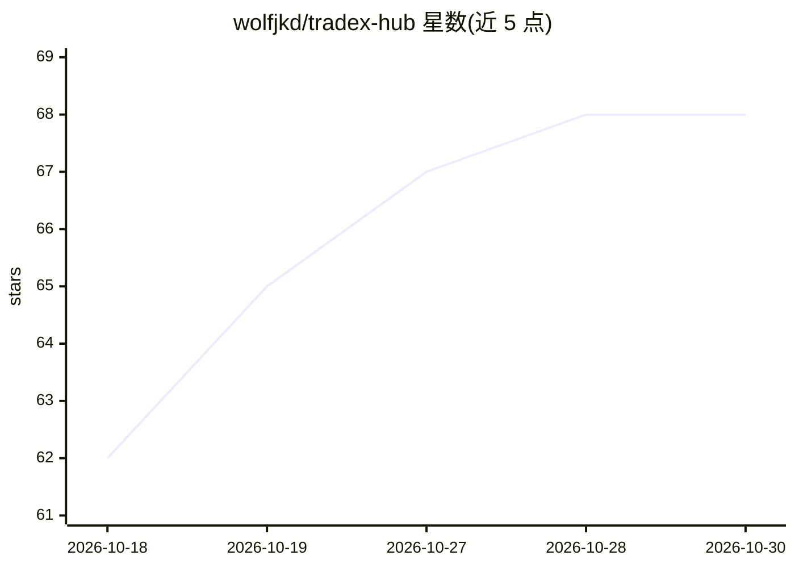

# wolfjkd/tradex-hub

⭐ 68 · Python · 推送 2026-10-20 · [GitHub](https://github.com/wolfjkd/tradex-hub) · 个人维护 · 中文 README

**本地运行的 A 股金融数据中台，供 AI Agent 统一调用**

tradex-hub 是本地运行的金融数据网关：把通达信（eltdx/TQ/官方 MCP）、腾讯财经、东方财富、同花顺、AKShare 等多个 A 股数据源统一封装为 168 个 MCP 工具与 58 个 REST 端点，供 Claude Code、Cursor、Dify、LangChain 等 AI Agent 及前端看板调用。核心机制 SmartRouter 按封禁风险分三梯队选源、健康检查、自动降级；提供技术指标计算、交易信号生成、条件选股等量化功能，Prometheus 监控与三层令牌桶限流。Python 3.13+，git clone 源码安装，默认本地运行不提供云服务。

## 筛选速览

| 维度 | 判定 | 备注 |
|---|---|---|
| AI 角色 | `ai-ecosystem` | LLM/agent 周边工具 |
| 许可风险 | `none` | — |
| 部署形态 | `None` |  |
| 模型依赖 | — | README 未给出锁定关系 |
| 硬件要求 | — | 无带数字的原话,不猜 |
| 安装摩擦 | `low` | 无编译、无系统依赖或容器化 |
| 成熟度 | — | 结构信号不足 |

## 能力要点

- 168 个 MCP 工具 + 58 个 REST 端点，双协议共享同一业务逻辑
- SmartRouter 多源路由：三梯队数据源自动降级与健康检查
- 量化计算与决策支持：技术指标、多因子分析、交易信号生成
- Prometheus 指标、监控看板、慢查询日志与访问日志双写

## 适用场景

- 让 AI Agent 通过 MCP 统一查询 A 股行情、财务与新闻数据
- 量化脚本通过 REST/SDK 调用技术指标计算与选股
- 为交易看板提供多源容灾的本地行情接口

## 场景标签

`金融量化` · 领域:学习与行业

## 证据(README 行号)

> L17: tradex-hub 是一个**本地运行的金融数据中台**，把分散在多个数据源（通达信、腾讯财经、东方财富、同花顺、新浪、巨潮、财联社、AKShare 等）的 A 股数据，统一封装成 **168 个 MCP 工具** + **58
> L19: **核心定位**：让 AI Agent **不用关心数据从哪儿来、怎么反爬、怎么降级** —— 只管调一个统一接口，tradex-hub 自动选最优数据源、自动健康检查、自动故障隔离。
> L55: |**MCP**|AI Agent 对话式调用（工具描述可被 LLM 理解）|JSON-RPC over HTTP，168 个工具|

## 星数曲线

2026-10-18 62 → 2026-10-30 68（+6）

---
*卡片 v1 · prompt 1.4 · 生成 2026-10-24 · 置信度 high · 依据 README sha `706f5292da48` · [字段定义](../../DATASET.md)*
