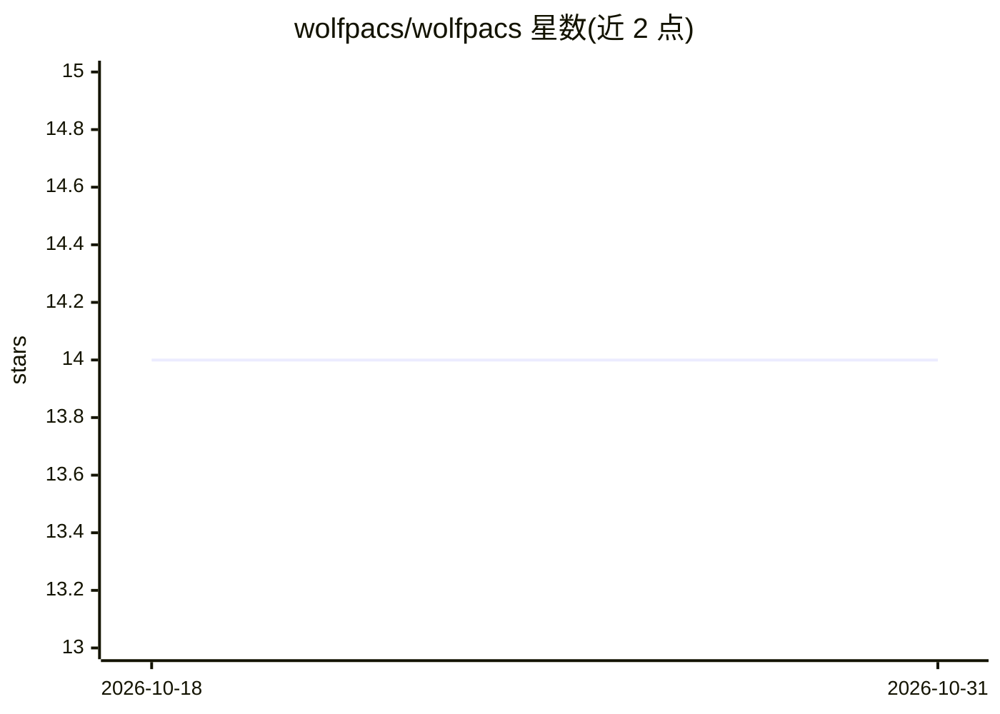

# wolfpacs/wolfpacs

⭐ 14 · Erlang · AGPL-3.0 · 推送 2026-04-25 · [GitHub](https://github.com/wolfpacs/wolfpacs) · [官网](https://wolfpacs.github.io/) · 个人维护

**DICOM 负载均衡器：把医学影像分发到多个 AI worker**

用 Erlang 编写的 DICOM 负载均衡器，面向放射科 AI 场景：接收外部客户端（如医院 PACS）发来的 DICOM 序列，按端口分离内外两侧（外部 11112/内部 11113），把影像路由到合适的 worker 处理，并将 worker 产出的衍生序列回送至正确目的地。支持三种 DICOM transfer syntax，可通过环境变量配置端口，以 Docker 镜像方式运行。项目自述处于 Alpha 阶段，可能残留关键缺陷，需更多黑盒测试。

## 筛选速览

| 维度 | 判定 | 备注 |
|---|---|---|
| AI 角色 | `ai-ecosystem` | LLM/agent 周边工具 |
| 许可风险 | `viral` | AGPL-3.0 |
| 部署形态 | `self-host` | docker 或自建部署 |
| 模型依赖 | — | README 未给出锁定关系 |
| 硬件要求 | — | 无带数字的原话,不猜 |
| 安装摩擦 | `low` | 无编译、无系统依赖或容器化 |
| 成熟度 | `idea` | |

## 能力要点

- DICOM 序列路由与负载均衡（worker 池内外端口分离）
- 支持 Implicit/Explicit VR Little Endian 与 Explicit VR Big Endian 三种 transfer syntax
- Docker 镜像一键运行，环境变量配置端口
- 单元/集成/验证/属性四层测试体系

## 适用场景

- 医学 AI 公司把 GPU worker 池组成并发服务多医院客户端
- 在不停机的情况下在 worker 间安全迁移负载
- 接收医院影像、回送 AI 分析后的衍生序列

## 场景标签

 · 领域:医学影像/基础设施工具

## 证据(README 行号)

> L14: With the advent of powerful AI solutions in Radiology,
> L16: **WolfPACS** acts as a load balancer, sending DICOM series to the correct worker.
> L20: > Enable a pool of heterogeneous workers (hardware, software) to serve multiple clients in a flexible way.

## 星数曲线

2026-10-18 14 → 2026-10-31 14（+0）

---
*卡片 v1 · prompt 1.4 · 生成 2026-10-31 · 置信度 high · 依据 README sha `430c4fb67c73` · [字段定义](../../DATASET.md)*
