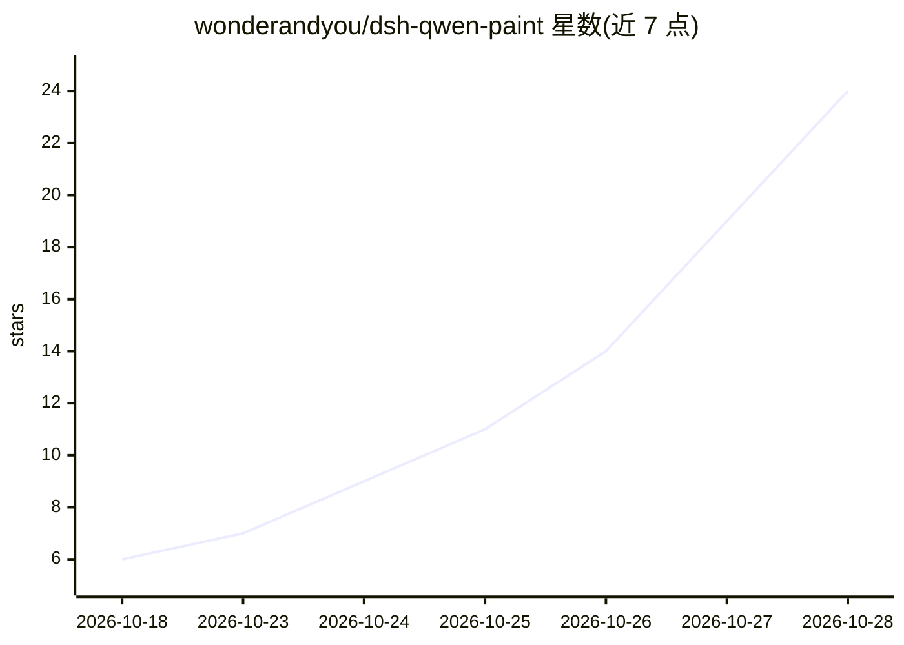

# wonderandyou/dsh-qwen-paint

⭐ 29 · JavaScript · MIT · 推送 2026-10-08 · [GitHub](https://github.com/wonderandyou/dsh-qwen-paint) · 个人维护 · 中文 README

**DSH 插件：对话中调用本机 ComfyUI 用千画出图**

为 DeepSeek Harness 桌面端提供的插件（host+client 两半），注册 draw_image 工具：按提示词调用本机 127.0.0.1:8188 的 ComfyUI，用 Qwen-Image 2.1 三个模型（约 13.3GB）生成图片并落盘到桌面目录，聊天框内联显示。全程本地不出网、不需 API Key，插件本体纯 Node ESM 零外部依赖。含一键部署脚本（自动下模型并 SHA256 校验）、空闲 5 分钟自动关停 ComfyUI、composer 下方在线状态指示器；N 卡开箱即用，A 卡走 ROCm（模型禁止商用）。

## 筛选速览

| 维度 | 判定 | 备注 |
|---|---|---|
| AI 角色 | `ai-native` | 本体是模型或模型工具 |
| 许可风险 | `permissive` | MIT |
| 部署形态 | `None` |  |
| 模型依赖 | — | README 未给出锁定关系 |
| 硬件要求 | — | 无带数字的原话,不猜 |
| 安装摩擦 | `low` | 无编译、无系统依赖或容器化 |
| 成熟度 | — | 结构信号不足 |

## 能力要点

- 注册 draw_image 工具，调本机 ComfyUI 用 Qwen-Image 2.1 出图并内联显示
- 一键部署脚本自动找 ComfyUI、下模型并逐个 SHA256 校验
- 空闲 5 分钟自动关停 ComfyUI（只杀可识别的 ComfyUI 进程，不打断队列任务）
- 纯 Node ESM、零外部依赖，不改 DSH 内核文件；附 138 项不联网自测

## 适用场景

- 在 DSH 聊天框里说一句话直接生成本地图
- 本地不出网、不花 API 费用的文生图
- 出图后自动关停 ComfyUI 释放显存

## 场景标签

`图像生成` · 领域:内容生成

## 证据(README 行号)

> L3: 让 **DeepSeek Harness** 在对话里直接调用**本机 ComfyUI**、用**千问 Qwen-Image 2.1** 画图。
> L14: |`draw_image`|按提示词调本机 ComfyUI 出图，成品落盘到「千问1生图」，并把绝对路径回给助手用于内联显示|

## 星数曲线

2026-10-18 6 → 2026-10-28 24（+18）

---
*卡片 v1 · prompt 1.4 · 生成 2026-10-28 · 置信度 high · 依据 README sha `4db648725cfb` · [字段定义](../../DATASET.md)*
