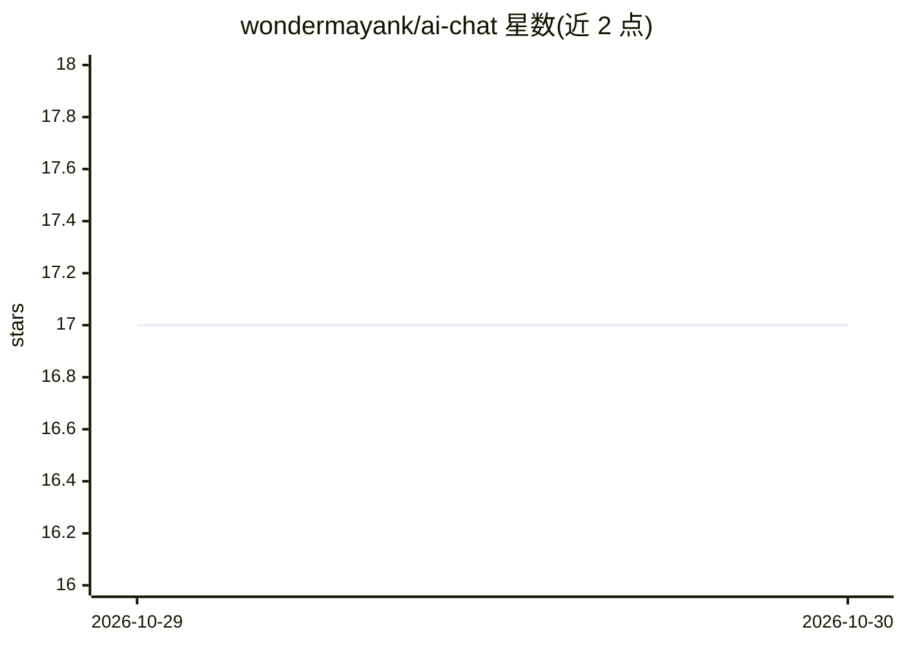

# wondermayank/ai-chat

⭐ 17 · HTML · 推送 2026-10-28 · [GitHub](https://github.com/wondermayank/ai-chat) · [官网](https://chat.thunderstudy.indevs.in/) · 个人维护

**面向 CUET/银行/商科学生的 AI 学习问答助手**

部署在 Cloudflare Pages Functions 上的网页聊天应用，面向 CUET、银行考试与商科学生的备考问答。聊天框中可选择多个由 Groq API 提供的模型（默认 Tiny，另有 Tiny Lite、bytes 等），选择保存在浏览器端；所选模型在当前 Groq key 下不可用时，服务端自动依次尝试其他模型并在界面标明实际应答者。模型列表可通过修改 functions/api/chat.js 中的 MODELS 与 index.html 调整，README 未展示完整安装步骤。

## 筛选速览

| 维度 | 判定 | 备注 |
|---|---|---|
| AI 角色 | `ai-native` | 本体是模型或模型工具 |
| 许可风险 | `none` | — |
| 部署形态 | `None` |  |
| 模型依赖 | — | README 未给出锁定关系 |
| 硬件要求 | — | 无带数字的原话,不猜 |
| 安装摩擦 | `low` | 无编译、无系统依赖或容器化 |
| 成熟度 | — | 结构信号不足 |

## 能力要点

- 基于 Cloudflare Pages Functions 的前端聊天 UI + API 部署
- 聊天框内多模型选择，选择记忆在浏览器端
- 所选模型不可用时服务端自动回退到其他模型

## 适用场景

- CUET 或银行考试备考中随时提问解题
- 商科课程学习中的即时答疑
- 作为 Groq 多模型切换的轻量聊天界面

## 场景标签

`聊天机器人` · 领域:对话与助手

## 证据(README 行号)

> L3: AI-powered study assistant for CUET, Banking & Commerce students.
> L6: ## AI models (pick from the chat box)

## 星数曲线

2026-10-29 17 → 2026-10-30 17（+0）

---
*卡片 v1 · prompt 1.4 · 生成 2026-10-29 · 置信度 mid · 依据 README sha `c2761d911f71` · [字段定义](../../DATASET.md)*
