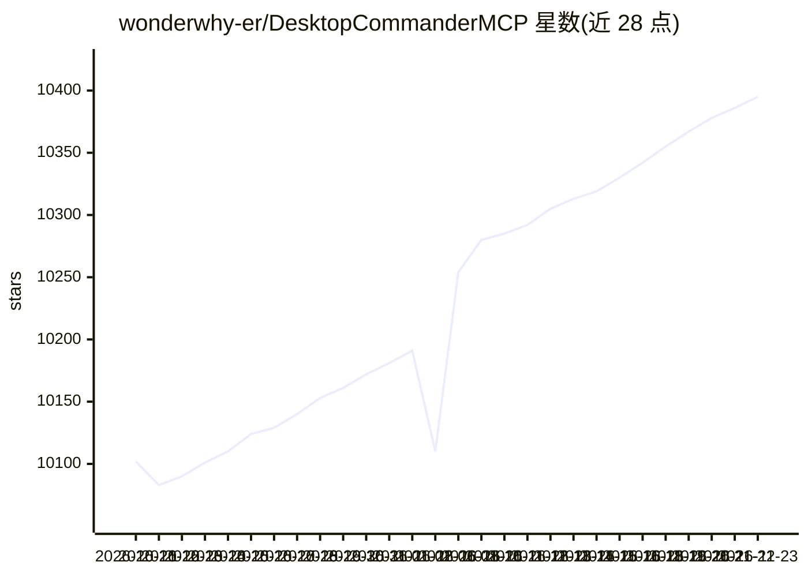

# wonderwhy-er/DesktopCommanderMCP

⭐ 10,395 · JavaScript · MIT · 推送 2026-11-20 · [GitHub](https://github.com/wonderwhy-er/DesktopCommanderMCP) · [官网](https://desktopcommander.app/) · 个人维护

**给 Claude 等 MCP 客户端提供终端控制与文件编辑能力的服务器**

一个 MCP 服务器，向 Claude Desktop、Cursor、VS Code 等 MCP 兼容客户端提供终端命令执行、文件系统操作、代码搜索与文件编辑能力。功能包括交互式进程控制、Python/Node.js/R 内存内执行、Excel/PDF/DOCX 读写、本地工具调用审计日志、符号链接防护与命令黑名单等安全护栏（非沙箱，可配合 Docker 隔离）。提供 npx、bash 安装脚本、Smithery、手动配置、git clone、Docker 六种安装方式，并支持 Remote MCP 使 ChatGPT/Claude web 可远程调用本机。

## 筛选速览

| 维度 | 判定 | 备注 |
|---|---|---|
| AI 角色 | `ai-ecosystem` | LLM/agent 周边工具 |
| 许可风险 | `permissive` | MIT |
| 部署形态 | `self-host` | docker 或自建部署 |
| 模型依赖 | — | README 未给出锁定关系 |
| 硬件要求 | — | 无带数字的原话,不猜 |
| 安装摩擦 | `low` | 无编译、无系统依赖或容器化 |
| 成熟度 | — | 结构信号不足 |

## 能力要点

- 向任意 MCP 兼容客户端提供终端、文件系统与 diff 编辑工具
- 支持 Excel/PDF/DOCX 原生读写与内存内代码执行
- 本地工具调用历史与审计日志，带轮转限制
- Remote MCP 模式支持从 ChatGPT/Claude web 控制本机，命令本地执行

## 适用场景

- 让 Claude Desktop 直接执行终端命令和批量修改代码文件
- 用自然语言让 AI 分析本机 CSV/JSON/Excel 数据
- 在 Docker 隔离环境中为 AI 客户端提供受控的工作环境

## 场景标签

 · 领域:AI 开发工具/MCP 基础设施

## 证据(README 行号)

> L1: # Desktop Commander MCP
> L2: ### Search, update, manage files and run terminal commands with AI
> L227: Desktop Commander works with any MCP-compatible client. The standard JSON configuration is:

## 星数曲线

2026-10-21 10,102 → 2026-11-23 10,395（+293）

---
*卡片 v1 · prompt 1.4 · 生成 2026-11-22 · 置信度 high · 依据 README sha `bc1778aa3761` · [字段定义](../../DATASET.md)*
