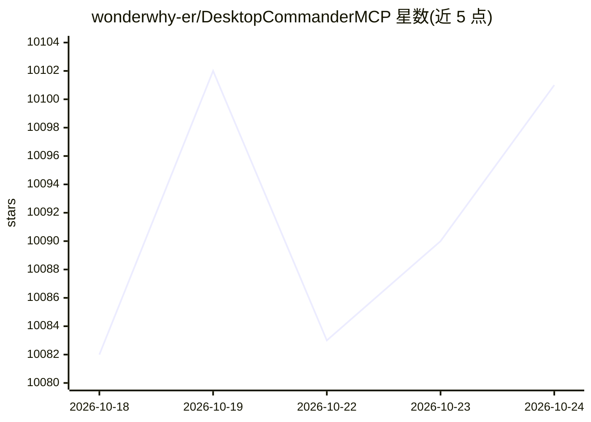

# wonderwhy-er/DesktopCommanderMCP

⭐ 10,110 · JavaScript · MIT · 推送 2026-10-24 · [GitHub](https://github.com/wonderwhy-er/DesktopCommanderMCP) · [官网](https://desktopcommander.app/) · 个人维护

**让 AI 客户端控制终端、文件系统与进程的 MCP 服务器**

面向 Claude Desktop 及其他 MCP 兼容客户端的 MCP 服务器：提供终端命令执行（流式输出、超时与后台执行、进程管理）、文件读写与搜索（含 Excel/PDF/DOCX 原生支持）、diff 式代码编辑、内存中执行 Python/Node.js/R 代码等工具，使用宿主客户端订阅而非 API token 计费。支持 Docker 隔离部署与 Remote MCP（从 ChatGPT/Claude web 远程调用、命令仍在本机执行），并内置符号链接防护、命令黑名单等非沙箱安全护栏与本地工具调用审计日志。

## 筛选速览

| 维度 | 判定 | 备注 |
|---|---|---|
| AI 角色 | `ai-ecosystem` | LLM/agent 周边工具 |
| 许可风险 | `permissive` | MIT |
| 部署形态 | `self-host` | docker 或自建部署 |
| 模型依赖 | locked-api |  |
| 硬件要求 | — | 无带数字的原话,不猜 |
| 安装摩擦 | `low` | 无编译、无系统依赖或容器化 |
| 成熟度 | — | 结构信号不足 |

## 能力要点

- 终端命令执行与交互式进程管理（SSH、数据库、开发服务器）
- 原生读写编辑 Excel/PDF/DOCX 文件
- 内存中执行 Python/Node.js/R 代码，无需保存文件
- Remote MCP：从 ChatGPT/Claude web 远程使用，命令在本机执行

## 适用场景

- 让 Claude 或其他 AI 客户端代替我执行终端命令和管理进程
- 让 AI 直接读写和编辑本地代码与 Office 文档
- 通过 Remote MCP 在网页版 AI 中操作自己电脑上的环境

## 场景标签

`Agent 框架` · 领域:Agent 开发

## 证据(README 行号)

> L1: # Desktop Commander MCP
> L2: ### Search, update, manage files and run terminal commands with AI
> L22: - **Remote AI Control** - Use Desktop Commander from ChatGPT, Claude web, and other AI services via Remote MCP

## 星数曲线

2026-10-18 10,082 → 2026-10-24 10,101（+19）

---
*卡片 v1 · prompt 1.4 · 生成 2026-10-20 · 置信度 high · 依据 README sha `0e158d0312f7` · [字段定义](../../DATASET.md)*
