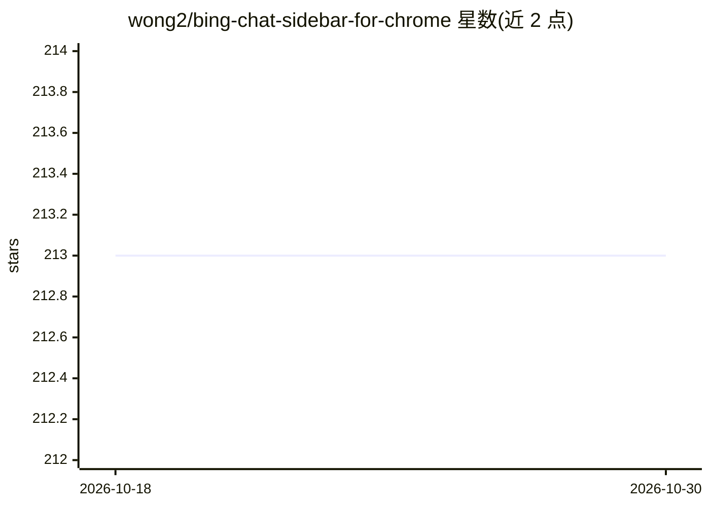

# wong2/bing-chat-sidebar-for-chrome

⭐ 213 · JavaScript · GPL-3.0 · 推送 2025-11-26 · [GitHub](https://github.com/wong2/bing-chat-sidebar-for-chrome) · [官网](https://chrome.google.com/webstore/detail/bing-sidebar-for-chrome/ncjedehfkpnliaafimjhdjjeggmfmlgf) · 个人维护

**在 Chrome 中使用 Edge 版 Bing Chat 侧边栏的扩展**

Chrome 浏览器扩展，将 Microsoft Edge 内置的 AI Bing 侧边栏通过逆向工程方式移植到 Chrome，保留访问当前网页或 PDF 等功能。基于 chrome.sidePanel API 实现，要求 Chrome 114 及以上版本，不兼容 Brave、Arc、Opera 等 Chromium 系浏览器。请求由浏览器直接通过 HTTPS 发往 Bing 服务器，无中间服务器，扩展不收集用户数据。通过 Chrome Web Store 安装。

## 筛选速览

| 维度 | 判定 | 备注 |
|---|---|---|
| AI 角色 | `ai-native` | 本体是模型或模型工具 |
| 许可风险 | `viral` | GPL-3.0 |
| 部署形态 | `None` |  |
| 模型依赖 | — | README 未给出锁定关系 |
| 硬件要求 | — | 无带数字的原话,不猜 |
| 安装摩擦 | `low` | 无编译、无系统依赖或容器化 |
| 成熟度 | — | 结构信号不足 |

## 能力要点

- 将 Edge 的 Bing 侧边栏移植到 Chrome
- 支持访问当前网页或 PDF
- 请求直连 Bing 服务器，无中间服务器，不收集用户数据

## 适用场景

- 在 Chrome 中使用 Bing Chat 侧边栏与网页/PDF 对话
- 不想切换 Edge 但需要 Bing Chat 集成体验的用户

## 场景标签

`聊天机器人` · 领域:对话与助手

## 证据(README 行号)

> L5: AI-powered Bing sidebar ported from Microsoft Edge to Chrome, with the same features like accessing the current webp
> L17: This extension uses the chrome.sidePanel API, which is only available since Chrome 114. Therefore it only works wit

## 星数曲线

2026-10-18 213 → 2026-10-30 213（+0）

---
*卡片 v1 · prompt 1.4 · 生成 2026-10-22 · 置信度 high · 依据 README sha `1311b5916ee9` · [字段定义](../../DATASET.md)*
