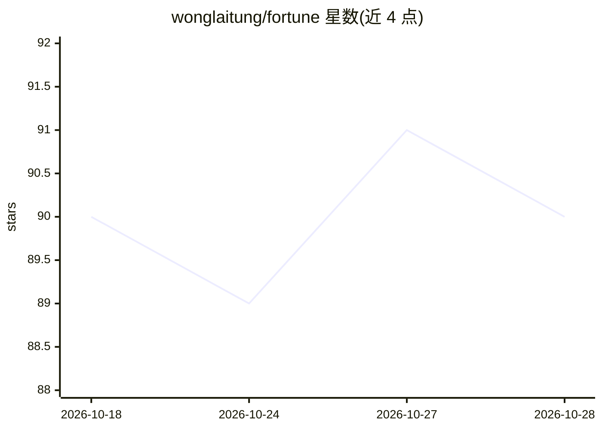

# wonglaitung/fortune

⭐ 90 · Python · 推送 2026-10-28 · [GitHub](https://github.com/wonglaitung/fortune) · 个人维护 · 中文 README

**港股/A股金融量化分析框架：ML 预测与大模型分析，附假设验证体系**

面向个人/小团队的金融量化研究框架，覆盖港股（32 只自选股，恒指三周期/个股预测/异常检测）与 A股（53 只股票池，三周期/买卖建议/板块分析），另有加密货币与黄金的外围监控。核心模型为 CatBoost（Walk-forward PIT/embargo），大模型经 OpenAI 兼容端点（opencode zen，deepseek-v4-flash）做解释与上下文，不作 alpha；数据来自 yfinance、腾讯财经与 AKShare。项目声明经严格验证未发现可交易 edge，自定位为工程化、展示与风控/研究框架，价值集中于假设验证体系（三道闸、决策台账、复现基线）。通过 git clone 从源码安装，GitHub Actions 定时调度，邮件推送报告。

## 筛选速览

| 维度 | 判定 | 备注 |
|---|---|---|
| AI 角色 | `ai-native` | 本体是模型或模型工具 |
| 许可风险 | `none` | — |
| 部署形态 | `None` |  |
| 模型依赖 | — | README 未给出锁定关系 |
| 硬件要求 | — | 无带数字的原话,不猜 |
| 安装摩擦 | `low` | 无编译、无系统依赖或容器化 |
| 成熟度 | — | 结构信号不足 |

## 能力要点

- CatBoost 三周期预测（5/10/20d）+ 异常检测（Z-Score + Isolation Forest）
- A/B/C 三道闸假设验证体系（泄漏/过拟合/净IR）与 70+ 条决策台账
- GitHub Actions 定时调度全流程自动化（数据采集→预测→邮件推送）
- 大模型经 OpenAI 兼容端点做解释分析，明确定位不作 alpha

## 适用场景

- 跑每日港股/A股分析报告作为研究参考
- 用三道闸与 Walk-forward 流程验证自己的量化策略假设
- 复用假设验证框架检验日频横截面策略的证据链

## 场景标签

`金融量化` · 领域:学习与行业

## 证据(README 行号)

> L5: 实践**人机混合智能**理念的**金融量化研究框架**：整合**大模型分析**与**机器学习预测**，覆盖**港股 / A股 两大市场**。
> L118: |①|🇭🇰 **港股预测系统**|恒指三周期 + 个股预测 + 异常检测|能跑的系统；**alpha 未发现**（不显著）|

## 星数曲线

2026-10-18 90 → 2026-10-28 90（+0）

---
*卡片 v1 · prompt 1.4 · 生成 2026-10-23 · 置信度 high · 依据 README sha `55587538f31c` · [字段定义](../../DATASET.md)*
