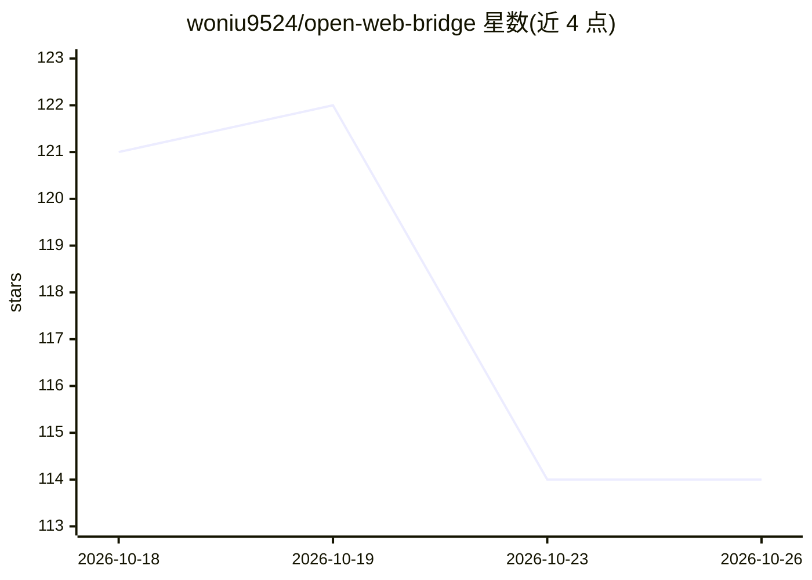

# woniu9524/open-web-bridge

⭐ 114 · JavaScript · MIT · 推送 2026-08-23 · [GitHub](https://github.com/woniu9524/open-web-bridge) · [官网](https://www.npmjs.com/package/open-web-bridge) · 个人维护 · 中文 README

**让任意 AI agent 驱动你真实 Chrome 的 CLI 桥接工具**

由 CLI（owb）+ MV3 Chrome 扩展 + 可选 Cloudflare Workers 中继组成的三层工具：AI agent 通过 shell 调用 80 条 owb 命令，驱动用户已登录、带真实指纹的浏览器，实现语义快照（@eN 元素引用）、CDP 真实鼠标事件、人工接管（验证码/扫码）、HAR 录制与重放、每站点会话保存等。面向使用 Claude Code、Codex、Kimi 等 CLI agent 的开发者。限制：需手动安装浏览器扩展；本地模式无配对令牌，不可在共享/多用户机器运行守护进程。

## 筛选速览

| 维度 | 判定 | 备注 |
|---|---|---|
| AI 角色 | `ai-ecosystem` | LLM/agent 周边工具 |
| 许可风险 | `permissive` | MIT |
| 部署形态 | `library` | 以包/库形式分发 |
| 模型依赖 | — | README 未给出锁定关系 |
| 硬件要求 | — | 无带数字的原话,不猜 |
| 安装摩擦 | `low` | 无编译、无系统依赖或容器化 |
| 成熟度 | — | 结构信号不足 |

## 能力要点

- 80 条 CLI 命令构成完整集成面，零客户端配置
- 语义快照用 @eN 稳定引用元素，since_last 只返回变化部分
- handoff/wait_user 人工接管验证码或扫码后自动恢复
- HAR 1.2 录制、转重放脚本、双录差异对比
- 可选 Relay 模式经 Cloudflare Workers 远程驱动浏览器且不开放端口

## 适用场景

- 让 CLI agent 读取我已登录的订阅内容或后台面板
- 把可用的工作流保存为确定性重放任务
- 抓取带请求/响应体的网络流量并转为重放脚本
- 远程 agent 经中继安全操控本机浏览器

## 场景标签

`浏览器自动化` · 领域:效率与自动化

## 证据(README 行号)

> L37:    AI agent               Claude Code · Codex · Kimi Code · anything with a shell
> L39:       │  owb <command>    the CLI is the entire integration surface — zero client config
> L101: `owb skill install` installs the skill for **every agent it detects** — Claude

## 星数曲线

2026-10-18 121 → 2026-10-26 114（-7）

---
*卡片 v1 · prompt 1.4 · 生成 2026-10-23 · 置信度 high · 依据 README sha `388307a3e079` · [字段定义](../../DATASET.md)*
