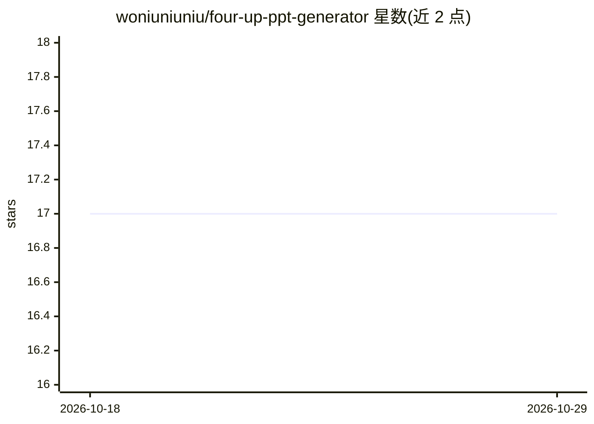

# woniuniuniu/four-up-ppt-generator

⭐ 17 · JavaScript · AGPL-3.0 · 推送 2026-07-17 · [GitHub](https://github.com/woniuniuniu/four-up-ppt-generator) · [官网](https://4ppt.vercel.app) · 个人维护 · 中文 README

**四路并行生成 HTML 演示文稿的中文 PPT 生成器**

基于 op7418/guizang-ppt-skill 构建的网页应用：输入一个主题后，A/B/C/D 四路独立请求模型，并行生成四份不同内容视角与视觉风格的 HTML PPT（默认约 9 页结构），生成过程中逐页实时预览，支持对单份 PPT 提交修改意见反复生成。默认调用百灵 Ling-3.0-flash 模型的 OpenAI 兼容接口，自部署版需用户自行填写模型配置与 API Key（随请求转发，不落盘）。提供 Vercel 托管演示与 npm 自部署两种方式，AGPL-3.0-only 开源。

## 筛选速览

| 维度 | 判定 | 备注 |
|---|---|---|
| AI 角色 | `ai-native` | 本体是模型或模型工具 |
| 许可风险 | `viral` | AGPL-3.0 |
| 部署形态 | `library` | 以包/库形式分发 |
| 模型依赖 | — | README 未给出锁定关系 |
| 硬件要求 | — | 无带数字的原话,不猜 |
| 安装摩擦 | `low` | 无编译、无系统依赖或容器化 |
| 成熟度 | — | 结构信号不足 |

## 能力要点

- A/B/C/D 四路并行生成不同视角与风格的 PPT
- 逐页实时预览与单份反馈修改的迭代生成
- HTML PPT 保留脚本、动画、WebGL 与交互能力
- 双模式密钥：托管版服务端环境变量或用户页面填写自己的模型配置

## 适用场景

- 输入主题快速得到多版不同风格的演示文稿再挑选
- 对某一份生成的 PPT 提修改意见反复迭代
- 自行部署到 Vercel 提供在线 PPT 生成体验

## 场景标签

`AI 写作` · 领域:内容生成

## 证据(README 行号)

> L5: 一个面向中文演示场景的四宫格 HTML PPT 生成器。输入一个主题后，系统会并行生成 A/B/C/D 四份不同内容视角、不同视觉风格的网页 PPT，并在生成过程中逐页同步预览。
> L38: - 四路并行生成：A/B/C/D 四份 PPT 独立请求模型，避免“一套内容换四个皮肤”。

## 星数曲线

2026-10-18 17 → 2026-10-29 17（+0）

---
*卡片 v1 · prompt 1.4 · 生成 2026-10-29 · 置信度 high · 依据 README sha `3e1e31197a9e` · [字段定义](../../DATASET.md)*
