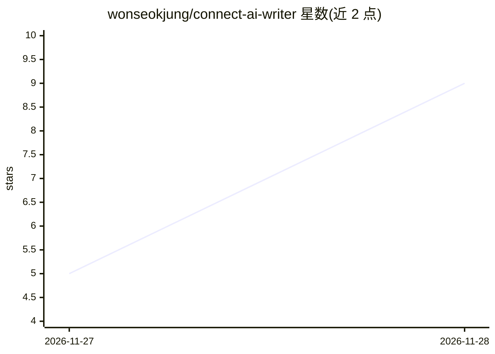

# wonseokjung/connect-ai-writer

⭐ 9 · JavaScript · NOASSERTION · 推送 2026-11-25 · [GitHub](https://github.com/wonseokjung/connect-ai-writer) · [官网](https://wonseokjung.github.io/connect-ai-writer/) · 个人维护

**给个人创作者与YouTuber的AI写作代理：一键产出多平台帖与配图**

以技能形式安装到编码代理（Claude Code、Codex、Cursor 等）的写作工具：输入一段视频，生成 Naver 博客、Threads、X、LinkedIn、Instagram 帖子与配图，附趋势查询（Google Trends、搜索建议、Wikipedia 浏览量）与带来源标注的研究。通过 voice sheet 从用户字幕提取用词习惯以贴合个人语气；发布前检查关键词位置、平台字数规则、数字/引语与来源一致性及翻译腔/AI 痕迹。输出保存在 out/ 目录，默认存草稿，--publish 才发布。需自行安装 Node.js 20.19+，无需付费 API key。

## 筛选速览

| 维度 | 判定 | 备注 |
|---|---|---|
| AI 角色 | `ai-native` | 本体是模型或模型工具 |
| 许可风险 | `none` | NOASSERTION |
| 部署形态 | `library` | 以包/库形式分发 |
| 模型依赖 | — | README 未给出锁定关系 |
| 硬件要求 | — | 无带数字的原话,不猜 |
| 安装摩擦 | `low` | 无编译、无系统依赖或容器化 |
| 成熟度 | — | 结构信号不足 |

## 能力要点

- 趋势、研究、博客、配图、绘本由一句话触发生成
- voice sheet 从字幕提取个人用词与句式，帖子据此生成
- 发布前校验平台字数规则、数字与引语一致性、AI 痕迹
- 图片来自视频截帧、引语卡与代码绘制图形，不生成虚构人物

## 适用场景

- 把课程视频转写成 Naver 博客与社交媒体帖子
- 查找当前趋势并做带来源的研究
- 生成可打印的插图绘本 PDF
- 一键分发同一条内容到五个平台

## 场景标签

`AI 写作` · 领域:内容生成

## 证据(README 行号)

> L8: **An AI writing employee for solo founders and YouTubers. Give it one of your videos, and it writes your Naver blog,
> L13: npx github:wonseokjung/connect-ai-writer install-skill
> L16: To install, paste that line into your agent's chat (Claude Code, Codex, Antigravity, Cursor) and ask it to install.

## 星数曲线

2026-11-27 5 → 2026-11-28 9（+4）

---
*卡片 v1 · prompt 1.4 · 生成 2026-11-27 · 置信度 high · 依据 README sha `790ae2bca659` · [字段定义](../../DATASET.md)*
