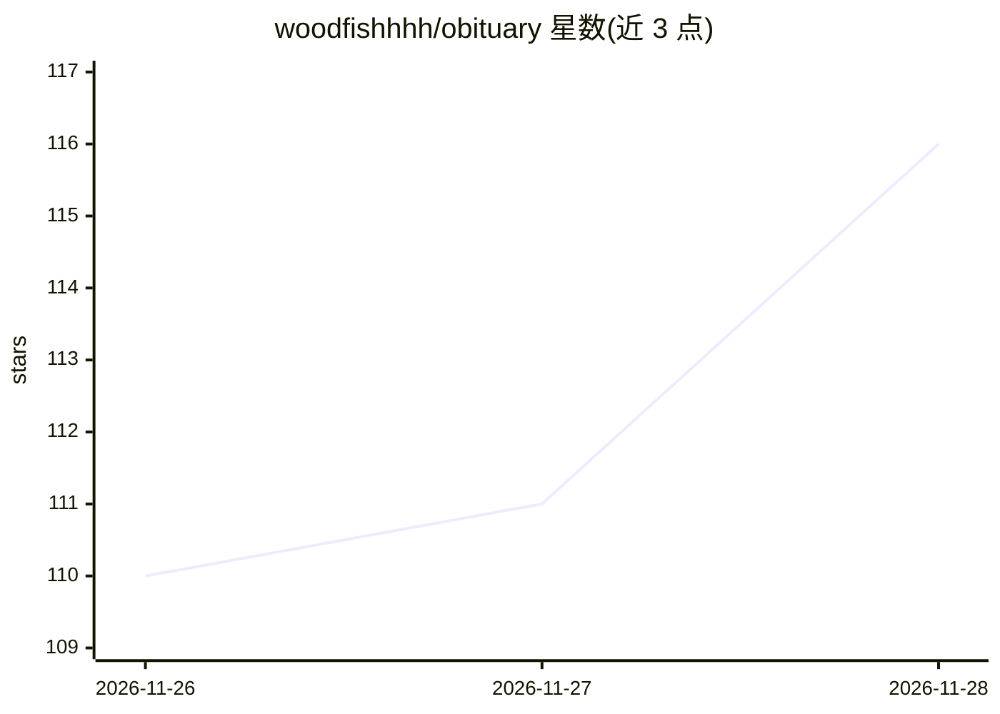

# woodfishhhh/obituary

⭐ 116 · Go · MIT · 推送 2026-11-27 · [GitHub](https://github.com/woodfishhhh/obituary) · [官网](obituary.woodfish.site) · 个人维护 · 中文 README

**面向 AI agent 的回收站：文件到期自毁，删除可七天还原**

为 AI agent 提供文件生命周期管理的 CLI 工具：通过 obit add/mark 给 agent 产出的调试脚本、日志、截图设置存活期，到期自动移入 graveyard，默认保留 7 天可随时原地还原（不覆盖现有文件），保留期后可真正清除。删除守护拦截 agent 的 rm -rf、git clean 等命令并转为入站操作，删除前校验真实路径并拒绝驱动器根、系统目录。obit init 通过 hooks、Agent Skill、可选 MCP 接入各 agent，支持 Windows/macOS/Linux 右键菜单、托盘、Docker 容器与文件夹策略。

## 筛选速览

| 维度 | 判定 | 备注 |
|---|---|---|
| AI 角色 | `ai-ecosystem` | LLM/agent 周边工具 |
| 许可风险 | `permissive` | MIT |
| 部署形态 | `None` |  |
| 模型依赖 | — | README 未给出锁定关系 |
| 硬件要求 | — | 无带数字的原话,不猜 |
| 安装摩擦 | `low` | 无编译、无系统依赖或容器化 |
| 成熟度 | `idea` | |

## 能力要点

- 删除守护：拦截 agent 的 rm -rf/git clean 并转换为可还原的入站操作
- 文件按卷序列号与 128 位文件 ID 追踪，改名移动仍可还原
- obit init 通过 hooks/Skill/可选 MCP 接入约 30 个 agent
- 支持 Docker 容器生命周期与文件夹策略（如 Downloads 自动入站）

## 适用场景

- 清理 agent 在项目中留下的调试脚本、日志和截图
- 防止 agent 误删文件导致不可恢复的损失
- 给临时 Docker 容器设定到期自动停止

## 场景标签

 · 领域:开发工具/agent 基础设施

## 证据(README 行号)

> L18: Obituary is the trash bin for AI agents: the agent and you decide what goes in. An agent gives the debug scripts, l
> L32: - **The agent decides what goes in.** `obit init` adds Obituary to the agent's instructions (`OBIT.md`, an Agent Sk
> L39: - **Claude Code and Codex.** `obit init` registers hooks and an Agent Skill; an MCP server is optional; `--uninstal

## 星数曲线

2026-11-26 110 → 2026-11-28 116（+6）

---
*卡片 v1 · prompt 1.4 · 生成 2026-11-28 · 置信度 high · 依据 README sha `8e0aff8a6712` · [字段定义](../../DATASET.md)*
